# Quantum Optics 2026/27 — Solutions to Homework 1, 2, 3

Each problem: conceptual questions → concept map → derivation from prerequisites. *Warning* callouts compare with the handwritten fragments. Typeset PDF version: `QO - Homework 1-3 solutions.pdf`.

# Conventions used throughout

Every symbol below is used with exactly this meaning in all three sets; where a problem needs something extra it is defined on the spot.

-   **Mode operators.** $\hat a,\hat b,\hat c,\hat d$ are annihilation operators of single bosonic modes; $\hat a^\dagger$ etc. are their Hermitian conjugates (creation operators). For one mode $[\hat a,\hat a^\dagger]=1$; operators of different modes commute. $\hat n_a=\hat a^\dagger\hat a$ is the photon-number operator, $\hat a\left|n\right\rangle=\sqrt n\left|n-1\right\rangle$, $\hat a^\dagger\left|n\right\rangle=\sqrt{n+1}\left|n+1\right\rangle$, and $\left|0\right\rangle$ (the vacuum) satisfies $\hat a\left|0\right\rangle=0$.

-   **Quadratures.** $\hat x=\tfrac12(\hat a+\hat a^\dagger)$, $\hat p=\tfrac1{2\mathrm{i}}(\hat a-\hat a^\dagger)$, so $\hat a=\hat x+\mathrm{i}\hat p$ and

$$
[\hat x,\hat p]=\tfrac{1}{4\mathrm{i}}\big[\hat a+\hat a^\dagger,\hat a-\hat a^\dagger\big]=\tfrac1{4\mathrm{i}}\big(-[\hat a,\hat a^\dagger]+[\hat a^\dagger,\hat a]\big)=\tfrac{1}{4\mathrm{i}}(-2)=\tfrac{\mathrm{i}}{2}.
$$

This is the commutator of position and momentum with an effective Planck constant $\hbar_{\rm eff}=\tfrac12$. In Homework 1 the same operators are called $\hat X_1\equiv\hat x$ and $\hat X_2\equiv \hat p$. In the position representation, $\hat p=-\tfrac{\mathrm{i}}{2}\,\partial_x$, because this is the unique (up to a gauge) differential operator with $[x,-\tfrac{\mathrm{i}}{2}\partial_x]f=-\tfrac{\mathrm{i}}2 x f'+\tfrac{\mathrm{i}}{2}(xf)'=\tfrac{\mathrm{i}}{2}f$. Vacuum variances are $\operatorname{Var}\hat x=\operatorname{Var}\hat p=\tfrac14$.

-   **Coherent state** $\left|\alpha\right\rangle$, $\alpha\in\mathbb C$, $\alpha=\alpha_r+\mathrm{i}\alpha_i$ with $\alpha_r=\operatorname{Re}\alpha$, $\alpha_i=\operatorname{Im}\alpha$: $\left|\alpha\right\rangle=\mathrm{e}^{-|\alpha|^2/2}\sum_{n\ge0}\frac{\alpha^n}{\sqrt{n!}}\left|n\right\rangle=\hat D(\alpha)\left|0\right\rangle$, with displacement operator $\hat D(\alpha)=\exp(\alpha\hat a^\dagger-\alpha^*\hat a)$.

-   **Squeeze operator.** $\hat S(\xi)=\exp\!\big[\tfrac12(\xi^*\hat a^2-\xi\hat a^{\dagger2})\big]$, $\xi=r\mathrm{e}^{\mathrm{i}\theta}$, $r\ge0$. We abbreviate $\mu=\cosh r$, $\nu=\mathrm{e}^{\mathrm{i}\theta}\sinh r$.

-   **50:50 beam splitter.** Input ports $a,b$, output ports $c,d$:

$$
\hat c=\tfrac{1}{\sqrt2}(\hat a+\hat b),\qquad \hat d=\tfrac1{\sqrt2}(\hat a-\hat b)\quad\Longleftrightarrow\quad
    \hat a=\tfrac{1}{\sqrt2}(\hat c+\hat d),\qquad \hat b=\tfrac1{\sqrt2}(\hat c-\hat d).
$$

(Your notes also use $\hat d=(\hat b-\hat a)/\sqrt2$; the two differ by a phase $-1$ on port $d$, which is a gauge choice and changes no photon-counting probability — see HW1.1, Step 1.)

-   **Wigner function** of a state with wave function $\psi(x)=\left\langle x\middle|\psi\right\rangle$ (with $\hbar_{\rm eff}=\tfrac12$):

$$
W(x,p)=\frac{1}{\pi\hbar_{\rm eff}}\int_{-\infty}^{\infty}\mathrm{d}y\;\psi^*(x+y)\,\psi(x-y)\,\mathrm{e}^{2\mathrm{i}py/\hbar_{\rm eff}}
    =\frac{2}{\pi}\int_{-\infty}^{\infty}\mathrm{d}y\;\psi^*(x+y)\,\psi(x-y)\,\mathrm{e}^{4\mathrm{i}py}.
$$

-   **Ensemble average** of a classical random quantity is written $\left\langle\cdot\right\rangle$; for operators $\left\langle\hat A\right\rangle=\left\langle\psi\right|\hat A\left|\psi\right\rangle$ or $\operatorname{Tr}(\hat\rho\hat A)$. Which one is meant is always clear from whether hats are present.

> [!note] Prerequisite (derived here, used later)
>
> **Gaussian integral.** For $a>0$ and real $b$ define
>
> $$
> I(a,b)\equiv\int_{-\infty}^{\infty}\mathrm{d}y\;\mathrm{e}^{-ay^2+\mathrm{i}by}.
> $$
>
> *(i) Value at $b=0$.* Square it and go to polar coordinates $y=\rho\cos\varphi$, $z=\rho\sin\varphi$, $\mathrm{d}y\,\mathrm{d}z=\rho\,\mathrm{d}\rho\,\mathrm{d}\varphi$:
>
> $$
> \begin{aligned}
> I(a,0)^2&=\int\!\!\int\mathrm{d}y\,\mathrm{d}z\;\mathrm{e}^{-a(y^2+z^2)}=\int_0^{2\pi}\!\mathrm{d}\varphi\int_0^\infty\!\rho\,\mathrm{d}\rho\;\mathrm{e}^{-a\rho^2}\\
> &=2\pi\cdot\frac{1}{2a}=\frac{\pi}{a}
> \quad\Rightarrow\quad I(a,0)=\sqrt{\pi/a}.
> \end{aligned}
> $$
>
> *(ii) Dependence on $b$.* Differentiate under the integral and integrate by parts, using $y\,\mathrm{e}^{-ay^2}=-\frac{1}{2a}\partial_y\mathrm{e}^{-ay^2}$:
>
> $$
> \begin{aligned}
> \frac{\partial I}{\partial b}&=\int\mathrm{d}y\;\mathrm{i}y\,\mathrm{e}^{-ay^2}\mathrm{e}^{\mathrm{i}by}
> =-\frac{\mathrm{i}}{2a}\int\mathrm{d}y\,\big(\partial_y\mathrm{e}^{-ay^2}\big)\mathrm{e}^{\mathrm{i}by}\\
> &=-\frac{\mathrm{i}}{2a}\Big[\mathrm{e}^{-ay^2+\mathrm{i}by}\Big]_{-\infty}^{\infty}+\frac{\mathrm{i}}{2a}\int\mathrm{d}y\;\mathrm{e}^{-ay^2}\,\mathrm{i}b\,\mathrm{e}^{\mathrm{i}by}
> =-\frac{b}{2a}\,I .
> \end{aligned}
> $$
>
> The boundary term vanishes because $\mathrm{e}^{-ay^2}\to0$. The ODE $\partial_b I=-\frac{b}{2a}I$ integrates to $\ln I=-\frac{b^2}{4a}+\text{const}$, and the constant is fixed by (i):
>
> $$
> \boxed{\;I(a,b)=\sqrt{\frac{\pi}{a}}\;\mathrm{e}^{-b^2/(4a)}\;}
> $$
>
> Both sides are analytic in $a$ (for $\operatorname{Re}a>0$) and in $b$, so the formula holds for complex $a$ with $\operatorname{Re}a>0$ and complex $b$ as well (analytic continuation; the integral converges uniformly there). Two special cases used repeatedly:
>
> $$
> \int\mathrm{d}y\,\mathrm{e}^{-y^2/(2\sigma^2)}=\sqrt{2\pi\sigma^2},\qquad
> \frac{1}{\sqrt{2\pi\sigma^2}}\int\mathrm{d}y\,\mathrm{e}^{-y^2/(2\sigma^2)}\mathrm{e}^{\mathrm{i}ky}=\mathrm{e}^{-\sigma^2k^2/2}.
> $$
>

> [!note] Prerequisite (derived here, used later)
>
> **Overlap of two coherent states.** Using the Fock expansion and $\left\langle m\middle|n\right\rangle=\delta_{mn}$,
>
> $$
> \left\langle\beta\middle|\alpha\right\rangle=\mathrm{e}^{-|\alpha|^2/2-|\beta|^2/2}\sum_{n}\frac{(\beta^*)^n\alpha^n}{n!}
> =\exp\!\Big(-\frac{|\alpha|^2}{2}-\frac{|\beta|^2}{2}+\beta^*\alpha\Big).
> $$
>
> Writing $\beta^*\alpha=\operatorname{Re}(\beta^*\alpha)+\mathrm{i}\operatorname{Im}(\beta^*\alpha)$ and $|\alpha-\beta|^2=|\alpha|^2+|\beta|^2-2\operatorname{Re}(\beta^*\alpha)$ gives the useful split
>
> $$
> \left\langle\beta\middle|\alpha\right\rangle=\mathrm{e}^{-|\alpha-\beta|^2/2}\;\mathrm{e}^{\mathrm{i}\operatorname{Im}(\beta^*\alpha)}:
> $$
>
> the modulus is fixed by the distance in phase space, but there is in general a *phase*. In particular $\left\langle-\alpha\middle|\alpha\right\rangle=\mathrm{e}^{-2|\alpha|^2}$ (real), while $\left\langle\alpha^*\middle|\alpha\right\rangle=\mathrm{e}^{-2\alpha_i^2}\,\mathrm{e}^{2\mathrm{i}\alpha_r\alpha_i}$ (complex) — this phase matters in HW3.3.
>

> [!note] Prerequisite (derived here, used later)
>
> **Two operator identities.** Let $\hat A,\hat B$ be operators.
>
> 1.  *Hadamard lemma.* $f(s)=\mathrm{e}^{s\hat A}\hat B\mathrm{e}^{-s\hat A}$ obeys $f'(s)=\mathrm{e}^{s\hat A}[\hat A,\hat B]\mathrm{e}^{-s\hat A}$, $f''(s)=\mathrm{e}^{s\hat A}[\hat A,[\hat A,\hat B]]\mathrm{e}^{-s\hat A}$, etc. Taylor-expanding at $s=0$ and setting $s=1$: $\mathrm{e}^{\hat A}\hat B\mathrm{e}^{-\hat A}=\hat B+[\hat A,\hat B]+\tfrac{1}{2!}[\hat A,[\hat A,\hat B]]+\dots$ If $[\hat A,\hat B]=c$ is a number, the series stops: $\mathrm{e}^{s\hat A}\hat B\mathrm{e}^{-s\hat A}=\hat B+sc$.
>
> 2.  *BCH for a central commutator.* If $[\hat A,\hat B]=c$ commutes with both, put $F(s)=\mathrm{e}^{s\hat A}\mathrm{e}^{s\hat B}$. Then $F'(s)=\hat A F+\mathrm{e}^{s\hat A}\hat B\mathrm{e}^{-s\hat A}F=(\hat A+\hat B+sc)F$. Because $\hat A+\hat B$ and $c$ commute, the solution with $F(0)=1$ is $F(s)=\mathrm{e}^{s(\hat A+\hat B)+s^2c/2}$. At $s=1$:
>
> $$
> \mathrm{e}^{\hat A}\mathrm{e}^{\hat B}=\mathrm{e}^{\hat A+\hat B}\,\mathrm{e}^{[\hat A,\hat B]/2}
>     \quad\Longleftrightarrow\quad
>     \mathrm{e}^{\hat A+\hat B}=\mathrm{e}^{\hat A}\mathrm{e}^{\hat B}\mathrm{e}^{-[\hat A,\hat B]/2}.
> $$
>
> In particular, if $[\hat A,\hat B]=0$ then $\mathrm{e}^{\hat A+\hat B}=\mathrm{e}^{\hat A}\mathrm{e}^{\hat B}$.
>
> 3.  *Unitary conjugation of a function.* For unitary $\hat U$, $\hat U\hat A^n\hat U^\dagger=(\hat U\hat A\hat U^\dagger)^n$ (insert $\hat U^\dagger\hat U=1$ between factors), hence for any power series $\hat U f(\hat A)\hat U^\dagger=f(\hat U\hat A\hat U^\dagger)$; e.g. $\hat U\mathrm{e}^{\hat A}\hat U^\dagger=\mathrm{e}^{\hat U\hat A\hat U^\dagger}$.
>

# Homework 1 — beam splitters, quadratures, cat states

## Problem 1.1: Polarisation Bell states at a beam splitter

> [!quote] Problem statement
>
> Check how correlations in the input state affect the outcome of a beam splitter: send the four polarisation Bell states $\frac{1}{\sqrt2}(\left|H\right\rangle\left|V\right\rangle\pm\left|V\right\rangle\left|H\right\rangle)$ and $\frac1{\sqrt2}(\left|H\right\rangle\left|H\right\rangle\pm\left|V\right\rangle\left|V\right\rangle)$ into the two input ports of a 50:50 beam splitter (one photon per port). Can coincidences occur?
>

> [!question] Conceptual challenges (answer each before reading on)
>
> 1.  How many modes does the problem have, and how does one write “$\left|H\right\rangle\left|V\right\rangle$” with creation operators? $\to$ Step 2
>
> 2.  Why must a lossless beam splitter be a *unitary* $2\times2$ matrix on the mode operators, and why are its overall signs a gauge choice? $\to$ Step 1
>
> 3.  Does a polarisation-independent beam splitter act on polarisation at all? $\to$ Step 1
>
> 4.  Why can I simply substitute $\hat a^\dagger=(\hat c^\dagger+\hat d^\dagger)/\sqrt2$ into the input state to obtain the output state, and what happens to the vacuum? $\to$ Step 3
>
> 5.  What operator measures “one photon in $c$ and one in $d$” for a two-photon state? $\to$ Step 5
>
> 6.  Bosons: total state symmetric under exchange. If the polarisation part is antisymmetric, what must the spatial part be? $\to$ Step 6
>

### Concept map

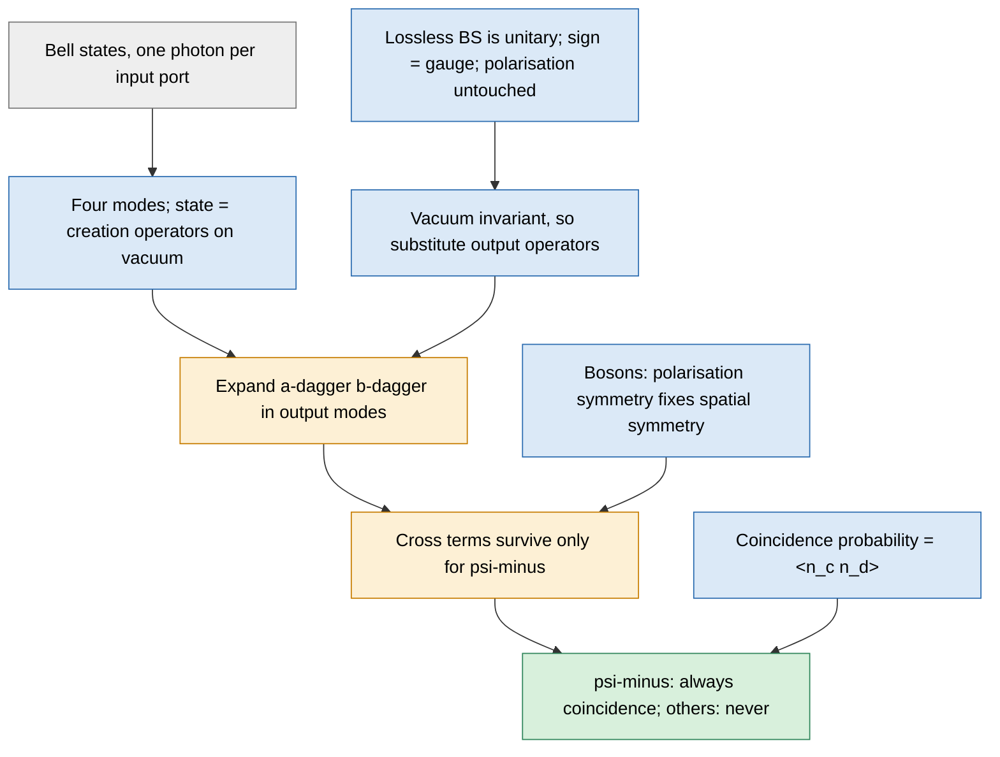

### Derivation

#### Step 1: The beam splitter as a unitary mode transformation

A lossless beam splitter maps the two input modes onto two output modes linearly, $\binom{\hat c}{\hat d}=U\binom{\hat a}{\hat b}$, $U=\begin{pmatrix}t&r'\\ r&t'\end{pmatrix}$. The outputs must again be independent bosonic modes, i.e. $[\hat c,\hat c^\dagger]=[\hat d,\hat d^\dagger]=1$ and $[\hat c,\hat d^\dagger]=0$. Inserting the linear map,

$$
[\hat c,\hat c^\dagger]=|t|^2+|r'|^2,\qquad [\hat d,\hat d^\dagger]=|r|^2+|t'|^2,\qquad [\hat c,\hat d^\dagger]=t r^*+r't'^*,
$$

so the three conditions are exactly the rows of $UU^\dagger=\mathbb 1$: $U$ must be unitary. For a 50:50 splitter all moduli are $1/\sqrt2$ and the last condition fixes only one combination of phases, $\mathrm{e}^{\mathrm{i}(\varphi_t-\varphi_r)}=-\mathrm{e}^{\mathrm{i}(\varphi_{r'}-\varphi_{t'})}$. The remaining phases can be absorbed into redefinitions $\hat c\to\mathrm{e}^{\mathrm{i}\chi_c}\hat c$, $\hat d\to\mathrm{e}^{\mathrm{i}\chi_d}\hat d$ (and similarly at the input). A photodetector measures $\hat c^\dagger\hat c$, which is invariant under $\hat c\to \mathrm{e}^{\mathrm{i}\chi}\hat c$, hence all counting statistics are unchanged: the sign convention is a *gauge choice*. We take $t=r=r'=\tfrac1{\sqrt2}$, $t'=-\tfrac{1}{\sqrt2}$ (check: $tr^*+r't'^*=\tfrac12-\tfrac12=0$), i.e.

$$
\hat c=\tfrac1{\sqrt2}(\hat a+\hat b),\qquad \hat d=\tfrac1{\sqrt2}(\hat a-\hat b).
$$

The matrix $U=\tfrac{1}{\sqrt2}\begin{pmatrix}1&1\\1&-1\end{pmatrix}$ is real, symmetric and satisfies $U^2=\mathbb 1$, so $U^{-1}=U$ and

$$
\hat a^\dagger=\tfrac{1}{\sqrt2}(\hat c^\dagger+\hat d^\dagger),\qquad \hat b^\dagger=\tfrac{1}{\sqrt2}(\hat c^\dagger-\hat d^\dagger). \tag{1.1}
$$

A non-polarising beam splitter does this *identically and separately* for each polarisation $\sigma\in\{H,V\}$: $\hat c_\sigma=(\hat a_\sigma+\hat b_\sigma)/\sqrt2$, $\hat d_\sigma=(\hat a_\sigma-\hat b_\sigma)/\sqrt2$. It never mixes $H$ with $V$.

#### Step 2: Modes and input states

There are $2$ spatial modes $\times$ $2$ polarisations $=4$ modes: $\hat a_H,\hat a_V,\hat b_H,\hat b_V$, with $[\hat a_\sigma,\hat a^\dagger_{\sigma'}]=\delta_{\sigma\sigma'}$ and all operators of different modes commuting. “Photon 1 in port $a$ with polarisation $H$, photon 2 in port $b$ with polarisation $V$” is $\hat a_H^\dagger\hat b_V^\dagger\left|0\right\rangle$, where $\left|0\right\rangle$ is the four-mode vacuum. Hence

$$
\begin{aligned}
\left|\psi^\pm\right\rangle&=\tfrac1{\sqrt2}\big(\hat a_H^\dagger\hat b_V^\dagger\pm\hat a_V^\dagger\hat b_H^\dagger\big)\left|0\right\rangle,&
\left|\phi^\pm\right\rangle&=\tfrac1{\sqrt2}\big(\hat a_H^\dagger\hat b_H^\dagger\pm\hat a_V^\dagger\hat b_V^\dagger\big)\left|0\right\rangle .
\end{aligned}
$$

Each is normalised: the two terms are orthogonal single-occupation states of norm 1.

#### Step 3: Why substitution gives the output state

The physical field state does not change when we decide to describe it in a different basis of modes; the beam splitter’s only role is to make the detectors sit in modes $c$ and $d$. So we rewrite the creation operators of the input state through (1.1). The vacuum is the same in both bases: $\hat c_\sigma\left|0\right\rangle=\tfrac1{\sqrt2}(\hat a_\sigma+\hat b_\sigma)\left|0\right\rangle=0$ and likewise $\hat d_\sigma\left|0\right\rangle=0$, so $\left|0\right\rangle$ is annihilated by all output operators and is the output vacuum. (Equivalently, in the Schrödinger picture the beam-splitter unitary $\hat U_{\rm BS}$ satisfies $\hat U_{\rm BS}\left|0\right\rangle=\left|0\right\rangle$, which is what allows $\hat U_{\rm BS}f(\hat a^\dagger,\hat b^\dagger)\left|0\right\rangle=f(\hat U_{\rm BS}\hat a^\dagger\hat U_{\rm BS}^\dagger,\dots)\left|0\right\rangle$.)

#### Step 4: The key product

For any polarisations $\sigma,\sigma'$, by (1.1),

$$
\begin{aligned}
\hat a_\sigma^\dagger\hat b_{\sigma'}^\dagger
&=\tfrac12(\hat c_\sigma^\dagger+\hat d_\sigma^\dagger)(\hat c_{\sigma'}^\dagger-\hat d_{\sigma'}^\dagger)
=\tfrac12\Big(\hat c_\sigma^\dagger\hat c_{\sigma'}^\dagger-\hat c_\sigma^\dagger\hat d_{\sigma'}^\dagger+\hat d_\sigma^\dagger\hat c_{\sigma'}^\dagger-\hat d_\sigma^\dagger\hat d_{\sigma'}^\dagger\Big). \tag{1.2}
\end{aligned}
$$

The two middle terms are the “one photon in each output” (coincidence) amplitudes. All creation operators commute with each other, so the order of factors is irrelevant.

*$\left|\psi^-\right\rangle$.* Subtract (1.2) with $(\sigma,\sigma')=(V,H)$ from (1.2) with $(H,V)$:

$$
\begin{aligned}
\hat a_H^\dagger\hat b_V^\dagger-\hat a_V^\dagger\hat b_H^\dagger
&=\tfrac12\Big[\underbrace{(\hat c_H^\dagger\hat c_V^\dagger-\hat c_V^\dagger\hat c_H^\dagger)}_{=0}
+(-\hat c_H^\dagger\hat d_V^\dagger+\hat c_V^\dagger\hat d_H^\dagger)
+(\hat d_H^\dagger\hat c_V^\dagger-\hat d_V^\dagger\hat c_H^\dagger)
-\underbrace{(\hat d_H^\dagger\hat d_V^\dagger-\hat d_V^\dagger\hat d_H^\dagger)}_{=0}\Big]\\
&=\hat c_V^\dagger\hat d_H^\dagger-\hat c_H^\dagger\hat d_V^\dagger .
\end{aligned}
$$

*$\left|\psi^+\right\rangle$.* Adding instead, the cross terms cancel pairwise ($-\hat c_H^\dagger\hat d_V^\dagger+\hat d_V^\dagger\hat c_H^\dagger=0$ and $\hat d_H^\dagger\hat c_V^\dagger-\hat c_V^\dagger\hat d_H^\dagger=0$) and the same-port terms double:

$$
\hat a_H^\dagger\hat b_V^\dagger+\hat a_V^\dagger\hat b_H^\dagger=\hat c_H^\dagger\hat c_V^\dagger-\hat d_H^\dagger\hat d_V^\dagger .
$$

*$\left|\phi^\pm\right\rangle$.* For $\sigma=\sigma'$ the cross terms in (1.2) are $-\hat c_\sigma^\dagger\hat d_\sigma^\dagger+\hat d_\sigma^\dagger\hat c_\sigma^\dagger=0$ already, so $\hat a_\sigma^\dagger\hat b_\sigma^\dagger=\tfrac12(\hat c_\sigma^{\dagger2}-\hat d_\sigma^{\dagger2})$.

Using $\hat c^{\dagger2}\left|0\right\rangle=\sqrt2\left|2\right\rangle$, the four output states are

$$
\begin{aligned}
\left|\psi^-\right\rangle&\to\tfrac1{\sqrt2}\big(\left|1_{cV}1_{dH}\right\rangle-\left|1_{cH}1_{dV}\right\rangle\big),\\
\left|\psi^+\right\rangle&\to\tfrac1{\sqrt2}\big(\left|1_{cH}1_{cV}\right\rangle-\left|1_{dH}1_{dV}\right\rangle\big),\\
\left|\phi^\pm\right\rangle&\to\tfrac12\big(\left|2_{cH}\right\rangle-\left|2_{dH}\right\rangle\pm\left|2_{cV}\right\rangle\mp\left|2_{dV}\right\rangle\big).
\end{aligned}
$$

(Check of normalisation for $\phi^\pm$: four orthonormal terms with amplitude $\tfrac12$, total $4\cdot\tfrac14=1$.)

#### Step 5: Coincidence probability

A coincidence means $n_c=1$ and $n_d=1$ (polarisation not resolved), where $\hat n_c=\sum_\sigma\hat c^\dagger_\sigma\hat c_\sigma$. For a state with exactly two photons the only possibilities are $(n_c,n_d)\in\{(2,0),(1,1),(0,2)\}$, and the product $n_cn_d$ is $0,1,0$ respectively. Therefore

$$
P_{\rm coinc}=\left\langle\hat n_c\hat n_d\right\rangle=\sum_{\sigma\sigma'}\left\langle\Psi\right|\hat c_\sigma^\dagger\hat d^\dagger_{\sigma'}\hat d_{\sigma'}\hat c_\sigma\left|\Psi\right\rangle=\sum_{\sigma\sigma'}\big\|\hat d_{\sigma'}\hat c_\sigma\left|\Psi\right\rangle\big\|^2,
$$

where we reordered using that $\hat c_\sigma$ and $\hat d^\dagger_{\sigma'}$ commute. This is the unnormalised second-order cross-correlation $G^{(2)}_{cd}$ summed over polarisations.

-   $\psi^-$: $\hat d_H\hat c_V$ acting on $\tfrac{1}{\sqrt2}\hat c_V^\dagger\hat d_H^\dagger\left|0\right\rangle$ gives $\tfrac1{\sqrt2}\left|0\right\rangle$, and on the other term gives $0$; similarly for $\hat d_V\hat c_H$. So $P_{\rm coinc}=\tfrac12+\tfrac12=1$.

-   $\psi^+,\phi^\pm$: every term contains photons in one port only, so $\hat d_{\sigma'}\hat c_\sigma$ annihilates each term: $P_{\rm coinc}=0$.

The normalised cross-correlation $g^{(2)}_{cd}=\left\langle\hat n_c\hat n_d\right\rangle/(\left\langle\hat n_c\right\rangle\left\langle\hat n_d\right\rangle)$ has $\left\langle\hat n_c\right\rangle=\left\langle\hat n_d\right\rangle=1$ in all four cases (by the $c\leftrightarrow d$ symmetry of the outputs and $\hat n_c+\hat n_d=2$), so $g^{(2)}_{cd}=1$ for $\psi^-$ and $0$ for the others.

#### Step 6: Why: exchange symmetry

For two identical bosons the joint state is symmetric under exchanging the photons, and exchange acts on (spatial label)$\otimes$(polarisation). In first-quantised notation, $\left|\psi^\pm\right\rangle$ has polarisation part $\tfrac1{\sqrt2}(\left|HV\right\rangle\pm\left|VH\right\rangle)$, and the spatial part must have the same symmetry: $\tfrac1{\sqrt2}(\left|ab\right\rangle\pm\left|ba\right\rangle)$; the $\phi^\pm$ have symmetric polarisation and symmetric spatial part. The beam splitter acts as $U\otimes U$ on the two photons, which commutes with exchange, so it preserves the symmetry. With $\left|a\right\rangle\to(\left|c\right\rangle+\left|d\right\rangle)/\sqrt2$, $\left|b\right\rangle\to(\left|c\right\rangle-\left|d\right\rangle)/\sqrt2$:

$$
\left|ab\right\rangle-\left|ba\right\rangle\;\to\;\tfrac12\big[(\left|c\right\rangle+\left|d\right\rangle)(\left|c\right\rangle-\left|d\right\rangle)-(\left|c\right\rangle-\left|d\right\rangle)(\left|c\right\rangle+\left|d\right\rangle)\big]=\left|dc\right\rangle-\left|cd\right\rangle.
$$

An antisymmetric two-particle state cannot contain $\left|cc\right\rangle$ or $\left|dd\right\rangle$ (they are symmetric), so the photons *must* leave through different ports. A symmetric spatial state becomes $\left|cc\right\rangle-\left|dd\right\rangle$: the photons *must* leave together (Hong–Ou–Mandel bunching). The polarisation correlations of the input therefore decide the spatial correlations of the output.

#### Step 7: Compact matrix version (your notes)

Order the four input modes as $\hat A=(\hat a_H,\hat a_V,\hat b_H,\hat b_V)$ and write a general two-photon state as $\left|\Psi\right\rangle=\tfrac12\sum_{jk}\Psi_{jk}\hat A_j^\dagger\hat A_k^\dagger\left|0\right\rangle$ with a symmetric matrix $\Psi$ (only the symmetric part survives because the $\hat A^\dagger$ commute). Output modes $\hat B=\mathcal U\hat A$ with $\mathcal U=U\otimes\mathbb 1_{\rm pol}$ give $\hat A_j^\dagger=\sum_l\mathcal U_{lj}\hat B_l^\dagger$ (using unitarity, $\hat A=\mathcal U^\dagger\hat B$), hence

$$
\Psi'=\mathcal U\,\Psi\,\mathcal U^{T}.
$$

Moreover $\hat B_l\hat B_m\left|\Psi'\right\rangle=\tfrac12\sum_{jk}\Psi'_{jk}(\delta_{mj}\delta_{lk}+\delta_{mk}\delta_{lj})\left|0\right\rangle=\Psi'_{lm}\left|0\right\rangle$, so the probability of one photon in mode $l$ and one in mode $m\neq l$ is $|\Psi'_{lm}|^2$, and $\left\langle\Psi\middle|\Psi\right\rangle=\tfrac12\operatorname{Tr}\Psi^\dagger\Psi$. Writing $\Psi$ in spatial $\otimes$ polarisation blocks with $2\times2$ polarisation matrix $X$:

$$
\begin{aligned}
&\psi^+:\;X=\tfrac{1}{\sqrt2}\sigma_x,\quad \phi^\pm:\;X=\tfrac1{\sqrt2}\begin{pmatrix}1&0\\0&\pm1\end{pmatrix}&&(\text{symmetric }X,\ \Psi=\sigma_x\otimes X),\\
&\psi^-:\;X=\tfrac{1}{\sqrt2}\begin{pmatrix}0&1\\-1&0\end{pmatrix}&&(\text{antisymmetric }X,\ \Psi=\mathrm{i}\sigma_y\otimes X).
\end{aligned}
$$

With $U=(\sigma_x+\sigma_z)/\sqrt2$ (the Hadamard matrix), $U\sigma_xU^T=\sigma_z$ (diagonal in $c,d$: both photons in the same port) and $U\,\mathrm{i}\sigma_y\,U^T=-\mathrm{i}\sigma_y$ (off-diagonal: one photon per port). The coincidence probability is the sum of $|\Psi'_{lm}|^2$ over $l\in c$, $m\in d$, which equals $\operatorname{Tr}X^\dagger X=1$ for $\psi^-$ and $0$ otherwise.

> [!success] Result
>
> Only the singlet $\left|\psi^-\right\rangle$ gives coincidences, with certainty ($P_{\rm coinc}=1$); $\left|\psi^+\right\rangle$, $\left|\phi^+\right\rangle$, $\left|\phi^-\right\rangle$ give $P_{\rm coinc}=0$ (both photons always exit the same port). Antisymmetric polarisation forces an antisymmetric spatial wave function, which forbids bunching. This is the basis of the linear-optics Bell-state analyser: a coincidence heralds $\psi^-$; $\psi^+$ can be recognised by orthogonal polarisations in one port; $\phi^\pm$ cannot be separated.
>

> [!warning] Check of your handwritten fragments
>
> Your calculation of $G^{(2)}_{cd}=\tfrac12$ for $\psi^-$ is the contribution of a *single* polarisation pair ($\sigma=H,\sigma'=V$). Summing over the unresolved polarisations, $(H,V)$ and $(V,H)$, gives $P_{\rm coinc}=1$. Also, the first page uses $\hat d=(\hat b-\hat a)/\sqrt2$ and a later one $\hat d^\dagger=(\hat a^\dagger-\hat b^\dagger)/\sqrt2$; either is fine (gauge, Step 1) but they must not be mixed in one calculation.
>

## Problem 1.2: Quadrature statistics of a coherent state

> [!quote] Problem statement
>
> Consider $\hat X_1=(\hat a+\hat a^\dagger)/2$ and $\hat X_2=(\hat a-\hat a^\dagger)/2\mathrm{i}$. Calculate their expectation values and variances on a coherent state. Check whether the Heisenberg uncertainty relation is saturated.
>

> [!question] Conceptual challenges (answer each before reading on)
>
> 1.  Why is $\left|\alpha\right\rangle$ an eigenstate of $\hat a$ but not of $\hat a^\dagger$, and how does one evaluate $\left\langle\alpha\right|\hat a^\dagger\hat a\left|\alpha\right\rangle$ vs. $\left\langle\alpha\right|\hat a\hat a^\dagger\left|\alpha\right\rangle$? $\to$ Steps 1, 3
>
> 2.  What is $[\hat X_1,\hat X_2]$, and what is the precise form of the uncertainty relation (where does it come from)? $\to$ Steps 2, 4
>
> 3.  When is the Robertson inequality an equality? $\to$ Step 5
>

### Concept map

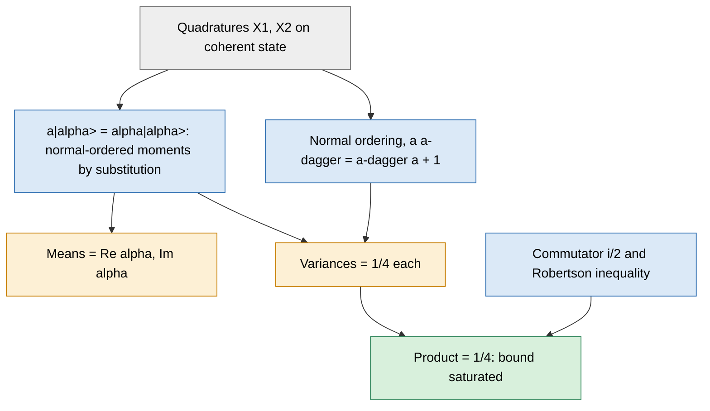

### Derivation

#### Step 1: Coherent state is an eigenstate of $\hat a$

From $\left|\alpha\right\rangle=\mathrm{e}^{-|\alpha|^2/2}\sum_n\frac{\alpha^n}{\sqrt{n!}}\left|n\right\rangle$ and $\hat a\left|n\right\rangle=\sqrt n\left|n-1\right\rangle$:

$$
\hat a\left|\alpha\right\rangle=\mathrm{e}^{-|\alpha|^2/2}\sum_{n\ge1}\frac{\alpha^n\sqrt n}{\sqrt{n!}}\left|n-1\right\rangle=\alpha\,\mathrm{e}^{-|\alpha|^2/2}\sum_{m\ge0}\frac{\alpha^m}{\sqrt{m!}}\left|m\right\rangle=\alpha\left|\alpha \right\rangle,
$$

with $m=n-1$ and $\sqrt n/\sqrt{n!}=1/\sqrt{(n-1)!}$. Taking the adjoint, $\left\langle\alpha\right|\hat a^\dagger=\alpha^*\left\langle\alpha\right|$. ($\hat a^\dagger$ has no normalisable eigenstates: it raises the lowest occupied Fock state.) Hence any *normally ordered* product (all $\hat a^\dagger$ to the left of all $\hat a$) is evaluated by replacement: $\left\langle\alpha\right|\hat a^{\dagger m}\hat a^{n}\left|\alpha\right\rangle=\alpha^{*m}\alpha^n$.

#### Step 2: The commutator

$[\hat X_1,\hat X_2]=\frac{1}{4\mathrm{i}}[\hat a+\hat a^\dagger,\hat a-\hat a^\dagger]=\frac{1}{4\mathrm{i}}\big(-[\hat a,\hat a^\dagger]+[\hat a^\dagger,\hat a]\big)=\frac{1}{4\mathrm{i}}(-1-1)=\frac{\mathrm{i}}{2}.$

#### Step 3: Means and variances

Means: $\left\langle\hat X_1\right\rangle=\tfrac12(\alpha+\alpha^*)=\operatorname{Re}\alpha$, $\left\langle\hat X_2\right\rangle=\tfrac{1}{2\mathrm{i}}(\alpha-\alpha^*)=\operatorname{Im}\alpha$.

Second moments: expand and normally order with $\hat a\hat a^\dagger=\hat a^\dagger\hat a+1$:

$$
\hat X_1^2=\tfrac14(\hat a^2+\hat a^{\dagger2}+\hat a\hat a^\dagger+\hat a^\dagger\hat a)=\tfrac14(\hat a^2+\hat a^{\dagger2}+2\hat a^\dagger\hat a+1),\qquad
\hat X_2^2=-\tfrac14(\hat a^2+\hat a^{\dagger2}-2\hat a^\dagger\hat a-1).
$$

Therefore

$$
\begin{aligned}
\left\langle\hat X_1^2\right\rangle&=\tfrac14(\alpha^2+\alpha^{*2}+2|\alpha|^2+1)=\tfrac14(\alpha+\alpha^*)^2+\tfrac14=(\operatorname{Re}\alpha)^2+\tfrac14,\\
\left\langle\hat X_2^2\right\rangle&=-\tfrac14(\alpha^2+\alpha^{*2}-2|\alpha|^2-1)=-\tfrac14(\alpha-\alpha^*)^2+\tfrac14=(\operatorname{Im}\alpha)^2+\tfrac14,
\end{aligned}
$$

using $(\alpha-\alpha^*)^2=(2\mathrm{i}\operatorname{Im}\alpha)^2=-4(\operatorname{Im}\alpha)^2$. Subtracting the squared means:

$$
\operatorname{Var}\hat X_1=\operatorname{Var}\hat X_2=\tfrac14,\qquad \Delta X_1=\Delta X_2=\tfrac12 ,
$$

independent of $\alpha$ — identical to the vacuum. The “$+\tfrac14$” is exactly the commutator term produced by normal ordering: a coherent state has no noise beyond vacuum noise.

#### Step 4: The uncertainty relation (Robertson)

For Hermitian $\hat A,\hat B$ and a state $\left|\psi\right\rangle$ put $\delta\hat A=\hat A-\left\langle\hat A\right\rangle$, $\left|f\right\rangle=\delta\hat A\left|\psi\right\rangle$, $\left|g\right\rangle=\delta\hat B\left|\psi\right\rangle$, so $\left\langle f\middle|f\right\rangle=\operatorname{Var}A$, $\left\langle g\middle|g\right\rangle=\operatorname{Var}B$. Cauchy–Schwarz and $|z|\ge|\operatorname{Im}z|$ give

$$
\operatorname{Var}A\,\operatorname{Var}B=\left\langle f\middle|f\right\rangle\left\langle g\middle|g\right\rangle\ge|\left\langle f\middle|g\right\rangle|^2\ge\Big(\frac{\left\langle f\middle|g\right\rangle-\left\langle g\middle|f\right\rangle}{2\mathrm{i}}\Big)^2=\Big|\frac{\left\langle[\hat A,\hat B]\right\rangle}{2\mathrm{i}}\Big|^2,
$$

since $\left\langle f\middle|g\right\rangle-\left\langle g\middle|f\right\rangle=\left\langle[\delta\hat A,\delta\hat B]\right\rangle=\left\langle[\hat A,\hat B]\right\rangle$. For the quadratures: $\Delta X_1\Delta X_2\ge\tfrac12|\left\langle[\hat X_1,\hat X_2]\right\rangle|=\tfrac14$.

#### Step 5: Saturation

$\Delta X_1\Delta X_2=\tfrac12\cdot\tfrac12=\tfrac14$: **saturated**. Equality in Cauchy–Schwarz requires $\left|g\right\rangle=\lambda\left|f\right\rangle$, and equality $|\left\langle f\middle|g\right\rangle|=|\operatorname{Im}\left\langle f\middle|g\right\rangle|$ requires $\left\langle f\middle|g\right\rangle$ purely imaginary, i.e. $\lambda$ imaginary. Rewriting: $(\delta\hat X_1+\mathrm{i}\kappa\,\delta\hat X_2)\left|\psi\right\rangle=0$ with real $\kappa$. For the coherent state, $\hat a-\alpha=\delta\hat X_1+\mathrm{i}\delta\hat X_2$ annihilates $\left|\alpha\right\rangle$, i.e. $\kappa=1$, which also forces equal variances. States with $\kappa\neq1$ are minimum-uncertainty states with unequal variances: the squeezed states of Homework 3.

> [!success] Result
>
> $\left\langle\hat X_1\right\rangle=\operatorname{Re}\alpha$, $\left\langle\hat X_2\right\rangle=\operatorname{Im}\alpha$, $\operatorname{Var}\hat X_1=\operatorname{Var}\hat X_2=\tfrac14$; $\Delta X_1\Delta X_2=\tfrac14=\tfrac12|\left\langle[\hat X_1,\hat X_2]\right\rangle|$: the coherent state is a minimum-uncertainty state with symmetric noise, for every $\alpha$.
>

## Problem 1.3: A Schrödinger cat at a beam splitter, photon parity

> [!quote] Problem statement
>
> Normalise $A(\left|\alpha\right\rangle+\left|-\alpha\right\rangle)$, inject it into one port of a 50:50 beam splitter with vacuum in the other, and with $\hat\Pi_{cd}=(-1)^{\hat n_c}\otimes(-1)^{\hat n_d}=\mathrm{e}^{\mathrm{i}\pi\hat c^\dagger\hat c}\mathrm{e}^{\mathrm{i}\pi\hat d^\dagger\hat d}$ (a) compute $\left\langle\hat\Pi_{cd}\right\rangle$ for the output; (b) find the probability of an odd number of photons at $c$ together with an odd number at $d$. Is this an analogue of the Hong–Ou–Mandel dip?
>

> [!question] Conceptual challenges (answer each before reading on)
>
> 1.  Are $\left|\alpha\right\rangle$ and $\left|-\alpha\right\rangle$ orthogonal? What is their overlap and how does it enter the norm? $\to$ Step 1
>
> 2.  Which Fock states does the even cat contain? $\to$ Step 2
>
> 3.  What does a beam splitter do to a coherent state with vacuum in the other port? (Why does a displacement factorise?) $\to$ Step 3
>
> 4.  How does $\mathrm{e}^{\mathrm{i}\pi\hat n}$ act on $\left|\beta\right\rangle$? $\to$ Step 4
>
> 5.  Why is total photon number — and hence total parity — conserved by the beam splitter? $\to$ Step 5
>
> 6.  How do I extract $P(\text{odd},\text{odd})$ from parity expectation values alone? $\to$ Step 6
>
> 7.  What is the HOM dip actually a dip *of*, and as a function of *what*? $\to$ Step 8
>

### Concept map

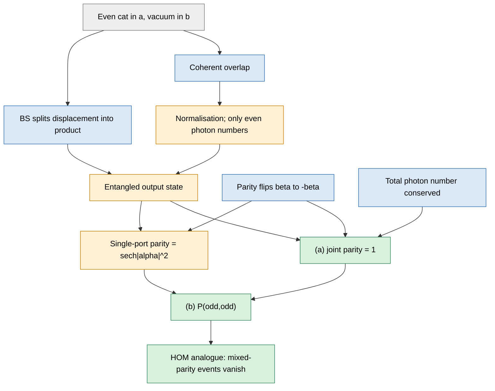

### Derivation

#### Step 1: Normalisation

$1=|A|^2\big(\left\langle\alpha\middle|\alpha\right\rangle+\left\langle-\alpha\middle|-\alpha\right\rangle+\left\langle\alpha\middle|-\alpha\right\rangle+\left\langle-\alpha\middle|\alpha\right\rangle\big)$. From the coherent-state overlap (Conventions), $\left\langle\alpha\middle|-\alpha\right\rangle=\exp(-\tfrac{|\alpha|^2}{2}-\tfrac{|\alpha|^2}2-|\alpha|^2)=\mathrm{e}^{-2|\alpha|^2}$, real, and the same for its conjugate. Choosing $A$ real and positive:

$$
A=\frac{1}{\sqrt{2\big(1+\mathrm{e}^{-2|\alpha|^2}\big)}}\,.
$$

For $|\alpha|\gg1$ the components are nearly orthogonal and $A\to1/\sqrt2$; for $\alpha\to0$, $A\to\tfrac12$ (the two components coincide with $\left|0\right\rangle$).

#### Step 2: Fock content

$\left|\alpha\right\rangle+\left|-\alpha\right\rangle=\mathrm{e}^{-|\alpha|^2/2}\sum_n\frac{\alpha^n}{\sqrt{n!}}\big(1+(-1)^n\big)\left|n\right\rangle=2\mathrm{e}^{-|\alpha|^2/2}\sum_{n\ \rm even}\frac{\alpha^n}{\sqrt{n!}}\left|n\right\rangle$: only even photon numbers — destructive interference of the odd components. The input has parity $(-1)^{\hat n_a}=+1$ with certainty, and port $b$ (vacuum) also has parity $+1$.

#### Step 3: Beam splitter acting on a coherent state

$\left|\alpha\right\rangle_a\left|0\right\rangle_b=\hat D_a(\alpha)\left|0\right\rangle$ with $\hat D_a(\alpha)=\exp(\alpha\hat a^\dagger-\alpha^*\hat a)$. Substitute (1.1), $\hat a^\dagger=(\hat c^\dagger+\hat d^\dagger)/\sqrt2$, $\hat a=(\hat c+\hat d)/\sqrt2$, and put $\tilde\alpha=\alpha/\sqrt2$:

$$
\alpha\hat a^\dagger-\alpha^*\hat a=\big(\tilde\alpha\hat c^\dagger-\tilde\alpha^*\hat c\big)+\big(\tilde\alpha\hat d^\dagger-\tilde\alpha^*\hat d\big).
$$

The two brackets involve different modes and commute, so by BCH (Conventions) the exponential factorises, $\hat D_a(\alpha)=\hat D_c(\tilde\alpha)\hat D_d(\tilde\alpha)$, and with the vacuum invariance of Problem 1.1, Step 3:

$$
\left|\alpha\right\rangle_a\left|0\right\rangle_b\;\to\;\left|\tilde\alpha\right\rangle_c\left|\tilde\alpha\right\rangle_d,\qquad \tilde\alpha=\alpha/\sqrt2 .
$$

A coherent state splits into a *product* of coherent states: no entanglement is created from a single coherent state. By linearity the cat gives

$$
\left|\Psi_{\rm out}\right\rangle=A\big(\left|\tilde\alpha\right\rangle_c\left|\tilde\alpha\right\rangle_d+\left|-\tilde\alpha\right\rangle_c\left|-\tilde\alpha\right\rangle_d\big),
$$

which *is* entangled (for $|\alpha|\gg1$ it is a Bell-like state $\tfrac{1}{\sqrt2}(\left|\uparrow\uparrow\right\rangle+\left|\downarrow\downarrow\right\rangle)$ of the two nearly orthogonal “qubit” states $\left|\pm\tilde\alpha\right\rangle$).

#### Step 4: Parity on a coherent state

$\mathrm{e}^{\mathrm{i}\pi\hat n}\left|n\right\rangle=\mathrm{e}^{\mathrm{i}\pi n}\left|n\right\rangle=(-1)^n\left|n\right\rangle$, hence $\mathrm{e}^{\mathrm{i}\pi\hat n}\left|\beta\right\rangle=\mathrm{e}^{-|\beta|^2/2}\sum_n\frac{(-\beta)^n}{\sqrt{n!}}\left|n\right\rangle=\left|-\beta\right\rangle$ (the prefactor depends only on $|\beta|=|-\beta|$). Parity is a rotation by $\pi$ in phase space.

#### Step 5: (a) Joint parity

$$
\hat\Pi_{cd}\left|\Psi_{\rm out}\right\rangle=A\big(\left|-\tilde\alpha\right\rangle\left|-\tilde\alpha\right\rangle+\left|\tilde\alpha\right\rangle\left|\tilde\alpha\right\rangle\big)=\left|\Psi_{\rm out}\right\rangle\quad\Rightarrow\quad\left\langle\hat\Pi_{cd}\right\rangle=\left\langle\Psi_{\rm out}\middle|\Psi_{\rm out}\right\rangle=1 .
$$

Independent check: $\hat n_c+\hat n_d=\tfrac12\big[(\hat a^\dagger+\hat b^\dagger)(\hat a+\hat b)+(\hat a^\dagger-\hat b^\dagger)(\hat a-\hat b)\big]=\hat a^\dagger\hat a+\hat b^\dagger\hat b$, so the beam splitter conserves total photon number and $\hat\Pi_{cd}=(-1)^{\hat n_c+\hat n_d}=(-1)^{\hat n_a+\hat n_b}$. The input has total parity $+1$ (Step 2), so the output must too, for every $\alpha$.

#### Step 6: (b) Probability of (odd, odd)

Let $P_{ee},P_{eo},P_{oe},P_{oo}$ be the joint parity probabilities ($e$ = even, $o$ = odd, first index port $c$). Then

$$
\begin{gathered}
P_{ee}+P_{eo}+P_{oe}+P_{oo}=1,\qquad
\left\langle\hat\Pi_{cd}\right\rangle=P_{ee}+P_{oo}-P_{eo}-P_{oe}=1,\\
\left\langle\hat\Pi_c\right\rangle\equiv\left\langle(-1)^{\hat n_c}\right\rangle=P_{ee}+P_{eo}-P_{oe}-P_{oo}.
\end{gathered}
$$

The first two give $P_{eo}=P_{oe}=0$ and $P_{ee}+P_{oo}=1$; then the third gives $\left\langle\hat\Pi_c\right\rangle=P_{ee}-P_{oo}=1-2P_{oo}$:

$$
P_{oo}=\frac{1-\left\langle\hat\Pi_c\right\rangle}{2}.
$$

Now compute the single-port parity. $\hat\Pi_c\left|\Psi_{\rm out}\right\rangle=A(\left|-\tilde\alpha\right\rangle\left|\tilde\alpha\right\rangle+\left|\tilde\alpha\right\rangle\left|-\tilde\alpha\right\rangle)$, so

$$
\begin{aligned}
\left\langle\hat\Pi_c\right\rangle&=A^2\Big[\left\langle\tilde\alpha\middle|-\tilde\alpha\right\rangle\left\langle\tilde\alpha\middle|\tilde\alpha\right\rangle+\left\langle\tilde\alpha\middle|\tilde\alpha\right\rangle\left\langle\tilde\alpha\middle|-\tilde\alpha\right\rangle
+\left\langle-\tilde\alpha\middle|-\tilde\alpha\right\rangle\left\langle-\tilde\alpha\middle|\tilde\alpha\right\rangle+\left\langle-\tilde\alpha\middle|\tilde\alpha\right\rangle\left\langle-\tilde\alpha\middle|-\tilde\alpha\right\rangle\Big]\\
&=4A^2\mathrm{e}^{-2|\tilde\alpha|^2}=\frac{4\mathrm{e}^{-|\alpha|^2}}{2(1+\mathrm{e}^{-2|\alpha|^2})}=\frac{2}{\mathrm{e}^{|\alpha|^2}+\mathrm{e}^{-|\alpha|^2}}=\operatorname{sech}|\alpha|^2 .
\end{aligned}
$$

(The first factor in each product is the port-$c$ overlap, the second the port-$d$ overlap; $2|\tilde\alpha|^2=|\alpha|^2$.) Hence

$$
\boxed{\;P_{oo}=\frac{1-\operatorname{sech}|\alpha|^2}{2},\qquad P_{ee}=\frac{1+\operatorname{sech}|\alpha|^2}{2},\qquad P_{eo}=P_{oe}=0\;}
$$

#### Step 7: Limits and a Fock-space check

$\operatorname{sech}x=1-\tfrac{x^2}{2}+O(x^4)$, so $P_{oo}\simeq|\alpha|^4/4$ for $|\alpha|\ll1$, and $P_{oo}\to\tfrac12$ for $|\alpha|\to\infty$. Check of the small-$\alpha$ limit directly: the normalised even cat is $\left|0\right\rangle+\tfrac{\alpha^2}{\sqrt2}\left|2\right\rangle+O(\alpha^4)$. The two-photon component splits as $\tfrac{\hat a^{\dagger2}}{\sqrt2}\left|0\right\rangle=\tfrac{(\hat c^\dagger+\hat d^\dagger)^2}{2\sqrt2}\left|0\right\rangle=\tfrac12\left|2,0\right\rangle+\tfrac1{\sqrt2}\left|1,1\right\rangle+\tfrac12\left|0,2\right\rangle$, so $P(1,1)=\big|\tfrac{\alpha^2}{\sqrt2}\big|^2\cdot\tfrac12=\tfrac{|\alpha|^4}{4}$. $\checkmark$

#### Step 8: Is this an analogue of the HOM dip?

In HOM, the input $\left|1\right\rangle_a\left|1\right\rangle_b$ has two indistinguishable paths to a coincidence (both transmitted, amplitude $t^2$; both reflected, amplitude $rr'$), which cancel exactly for a 50:50 splitter. The *dip* is the drop of the coincidence rate from its classical (distinguishable-photon) value $\tfrac12$ to $0$ as the photons are made indistinguishable. The proper analogue here is the event class that is forbidden: the *mixed-parity* events $(e,o)$ and $(o,e)$, not $(o,o)$. To see that this is an interference effect and not a triviality, replace the cat by the *incoherent mixture* $\hat\rho_{\rm mix}=\tfrac12(\left|\alpha\right\rangle\left\langle\alpha\right|+\left|-\alpha\right\rangle\left\langle-\alpha\right|)$, which has the same “which-component” content but no coherence. Each component exits as a product $\left|\pm\tilde\alpha\right\rangle\left|\pm\tilde\alpha\right\rangle$ in which the two ports are independent, with $P_{\rm odd}(\tilde\alpha)=\tfrac12(1-\left\langle\tilde\alpha\middle|-\tilde\alpha\right\rangle)=\tfrac12(1-\mathrm{e}^{-|\alpha|^2})$ (Step 4: $\left\langle(-1)^{\hat n}\right\rangle_\beta=\left\langle\beta\middle|-\beta\right\rangle$). Hence for the mixture

$$
P_{eo}+P_{oe}=2P_eP_o=\frac{1-\mathrm{e}^{-2|\alpha|^2}}{2}\neq0,
$$

whereas the coherent superposition gives exactly $0$. The coherence between the two indistinguishable alternatives $\left|\tilde\alpha\tilde\alpha\right\rangle$ and $\left|-\tilde\alpha,-\tilde\alpha\right\rangle$ removes a class of coincidences — a dip as a function of the cat’s coherence, analogous to the HOM dip as a function of distinguishability. The difference: HOM relies on the specific 50:50 amplitude cancellation of a two-photon state, whereas here the zero follows from conservation of total parity for an input that is a parity eigenstate, and holds for any splitting ratio.

> [!success] Result
>
> $A=[2(1+\mathrm{e}^{-2|\alpha|^2})]^{-1/2}$; output $A(\left|\tilde\alpha\tilde\alpha\right\rangle+\left|-\tilde\alpha,-\tilde\alpha\right\rangle)$ with $\tilde\alpha=\alpha/\sqrt2$; (a) $\left\langle\hat\Pi_{cd}\right\rangle=1$; (b) $P_{oo}=\tfrac12(1-\operatorname{sech}|\alpha|^2)$, while mixed-parity coincidences vanish identically. The HOM analogue is the vanishing of $(e,o)$/$(o,e)$ events, which reappear if the cat is replaced by a mixture.
>

> [!warning] Check of your handwritten fragments
>
> Your normalisation, $\left\langle\hat\Pi_c\right\rangle=\operatorname{sech}|\alpha|^2$ and $P_{oo}$ agree with the above. Your statement “what is zero here? $P(\text{even}_c,\text{odd}_d)$, because the beam splitter conserves $n_a+n_b=n_c+n_d$” is the correct core of the HOM question; the comparison with the mixture (Step 8) is what turns it into a “dip”.
>

## Additional problem 1.A: HOM dip with partial distinguishability and arbitrary splitting ratio

> [!quote] Problem statement
>
> Two single photons enter ports $a$ and $b$ of a lossless beam splitter with intensity transmission $T$ and reflection $R=1-T$. Photon $a$ has normalised spectral amplitude $\xi(\omega)$, photon $b$ has $\eta(\omega)$, with overlap $s=\int\mathrm{d}\omega\,\xi^*(\omega)\eta(\omega)$. (i) Find the coincidence probability. (ii) For $\eta(\omega)=\xi(\omega)\mathrm{e}^{\mathrm{i}\omega\tau}$ (photon $b$ delayed by $\tau$) and Gaussian $|\xi(\omega)|^2=(2\pi\sigma^2)^{-1/2}\mathrm{e}^{-(\omega-\omega_0)^2/(2\sigma^2)}$, give $P_{\rm c}(\tau)$ for $T=\tfrac12$.
>

> [!question] Conceptual challenges (answer each before reading on)
>
> 1.  What is a “photon in spectral mode $\xi$”? $\to$ Step 1
>
> 2.  How to split $\eta$ into a part identical to $\xi$ and a part orthogonal to it? $\to$ Step 2
>
> 3.  Which coincidence amplitudes interfere and which add incoherently? $\to$ Step 4
>

### Concept map

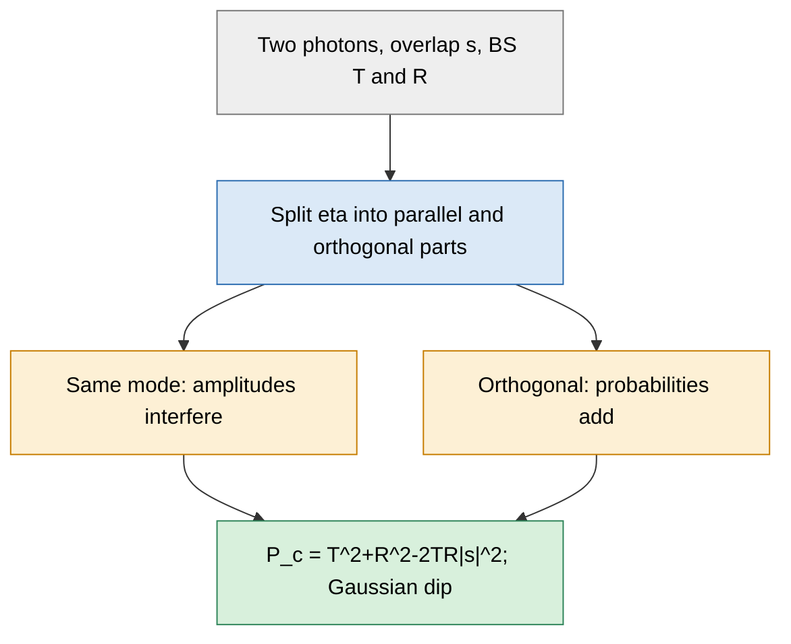

### Derivation

#### Step 1: Continuous-mode photons

Frequency-resolved operators obey $[\hat a(\omega),\hat a^\dagger(\omega')]=\delta(\omega-\omega')$. A photon in the normalised mode $\xi$ is $\hat a^\dagger_\xi\left|0\right\rangle$ with $\hat a_\xi^\dagger=\int\mathrm{d}\omega\,\xi(\omega)\hat a^\dagger(\omega)$; then $[\hat a_\xi,\hat a_\eta^\dagger]=\int\mathrm{d}\omega\,\xi^*\eta=s$, so modes $\xi,\eta$ are independent bosonic modes only if $s=0$.

#### Step 2: Orthogonal decomposition

Write $\eta=s\,\xi+\sqrt{1-|s|^2}\,\xi_\perp$ with $\xi_\perp=(\eta-s\xi)/\sqrt{1-|s|^2}$; one checks $\int\xi^*\xi_\perp=(s-s)/\sqrt{\cdot}=0$ and $\int|\xi_\perp|^2=1$. Therefore $\hat b^\dagger_\eta=s\,\hat b^\dagger_\xi+\sqrt{1-|s|^2}\,\hat b^\dagger_\perp$, and the input is

$$
\hat a^\dagger_\xi\hat b^\dagger_\eta\left|0\right\rangle=s\,\hat a^\dagger_\xi\hat b^\dagger_\xi\left|0\right\rangle+\sqrt{1-|s|^2}\,\hat a^\dagger_\xi\hat b^\dagger_\perp\left|0\right\rangle .
$$

#### Step 3: Beam splitter

Take the real unitary $\hat c=\sqrt T\hat a+\sqrt R\hat b$, $\hat d=\sqrt R\hat a-\sqrt T\hat b$ (rows orthonormal, $U^2=\mathbb 1$), frequency independent so it acts the same way on every spectral mode: $\hat a^\dagger=\sqrt T\hat c^\dagger+\sqrt R\hat d^\dagger$, $\hat b^\dagger=\sqrt R\hat c^\dagger-\sqrt T\hat d^\dagger$.

#### Step 4: Coincidence amplitudes

Same spectral mode: $\hat a_\xi^\dagger\hat b_\xi^\dagger=(\sqrt T\hat c_\xi^\dagger+\sqrt R\hat d_\xi^\dagger)(\sqrt R\hat c_\xi^\dagger-\sqrt T\hat d_\xi^\dagger)=\sqrt{TR}\,\hat c^{\dagger2}_\xi-\sqrt{TR}\,\hat d^{\dagger2}_\xi+(R-T)\,\hat c^\dagger_\xi\hat d^\dagger_\xi$. The two ways to a coincidence (both transmitted: $-T$; both reflected: $+R$) *add as amplitudes*.  
Orthogonal modes: $\hat a_\xi^\dagger\hat b_\perp^\dagger=\sqrt{TR}\,\hat c^\dagger_\xi\hat c^\dagger_\perp-\sqrt{TR}\,\hat d^\dagger_\xi\hat d^\dagger_\perp-T\,\hat c^\dagger_\xi\hat d^\dagger_\perp+R\,\hat d^\dagger_\xi\hat c^\dagger_\perp$. Now the two coincidence terms end in *different* (orthogonal) final states, so their probabilities add.  
The three coincidence states $\hat c^\dagger_\xi\hat d^\dagger_\xi\left|0\right\rangle$, $\hat c^\dagger_\xi\hat d^\dagger_\perp\left|0\right\rangle$, $\hat d^\dagger_\xi\hat c^\dagger_\perp\left|0\right\rangle$ are orthonormal, so

$$
P_{\rm c}=|s|^2(R-T)^2+(1-|s|^2)(T^2+R^2)=T^2+R^2-2TR\,|s|^2 .
$$

#### Step 5: Delay scan

$s=\int\mathrm{d}\omega|\xi|^2\mathrm{e}^{\mathrm{i}\omega\tau}=\mathrm{e}^{\mathrm{i}\omega_0\tau}\mathrm{e}^{-\sigma^2\tau^2/2}$ by the Gaussian characteristic function (Conventions). With $T=R=\tfrac12$:

$$
P_{\rm c}(\tau)=\tfrac12\big(1-\mathrm{e}^{-\sigma^2\tau^2}\big).
$$

> [!success] Result
>
> $P_{\rm c}=T^2+R^2-2TR|s|^2$. For 50:50: $P_{\rm c}=\tfrac12(1-|s|^2)$, a Gaussian dip of depth 100% and $1/\mathrm{e}$ half-width $\tau=1/\sigma$; for $T\neq R$ the dip bottoms out at $(T-R)^2$. Distinguishable photons ($s=0$) give the classical value $T^2+R^2$.
>

## Additional problem 1.B: The odd cat at a beam splitter

> [!quote] Problem statement
>
> Repeat Problem 1.3 for the odd cat $A_-(\left|\alpha\right\rangle-\left|-\alpha\right\rangle)$: normalise it, find the output state, $\left\langle\hat\Pi_{cd}\right\rangle$, $\left\langle\hat\Pi_c\right\rangle$ and all four joint parity probabilities. Check the limit $\alpha\to0$.
>

> [!question] Conceptual challenges (answer each before reading on)
>
> 1.  Which Fock states does the odd cat contain, and what is its parity? $\to$ Step 1
>
> 2.  Which parity events are forbidden at the output? $\to$ Step 2
>
> 3.  Why might $\left\langle\hat\Pi_c\right\rangle$ vanish identically? $\to$ Step 3
>

### Concept map

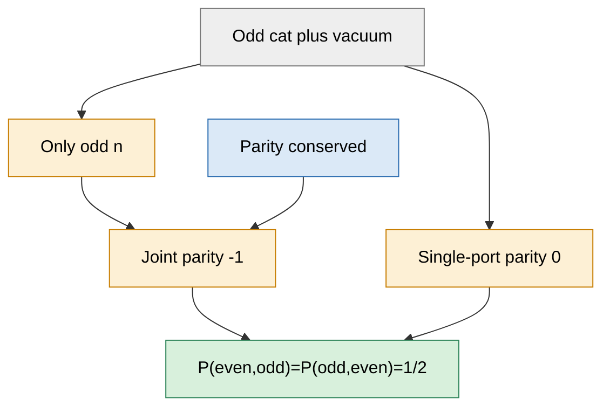

### Derivation

#### Step 1: Normalisation and parity

$1=A_-^2(2-2\mathrm{e}^{-2|\alpha|^2})\Rightarrow A_-=[2(1-\mathrm{e}^{-2|\alpha|^2})]^{-1/2}$. In the Fock basis the factor is $1-(-1)^n$: only odd $n$; parity $-1$.

#### Step 2: Output and joint parity

As in 1.3, $\left|\Psi_-\right\rangle=A_-(\left|\tilde\alpha\tilde\alpha\right\rangle-\left|-\tilde\alpha,-\tilde\alpha\right\rangle)$ and $\hat\Pi_{cd}\left|\Psi_-\right\rangle=-\left|\Psi_-\right\rangle$, so $\left\langle\hat\Pi_{cd}\right\rangle=-1$: $P_{ee}=P_{oo}=0$ and $P_{eo}+P_{oe}=1$.

#### Step 3: Single-port parity

$\hat\Pi_c\left|\Psi_-\right\rangle=A_-(\left|-\tilde\alpha,\tilde\alpha\right\rangle-\left|\tilde\alpha,-\tilde\alpha\right\rangle)$ and

$$
\left\langle\hat\Pi_c\right\rangle=A_-^2\big[\left\langle\tilde\alpha\middle|-\tilde\alpha\right\rangle-\left\langle\tilde\alpha\middle|-\tilde\alpha\right\rangle-\left\langle-\tilde\alpha\middle|\tilde\alpha\right\rangle+\left\langle-\tilde\alpha\middle|\tilde\alpha\right\rangle\big]=0 .
$$

With $\left\langle\hat\Pi_c\right\rangle=P_{ee}+P_{eo}-P_{oe}-P_{oo}=P_{eo}-P_{oe}$ we get $P_{eo}=P_{oe}=\tfrac12$ for every $\alpha$. (Symmetry reason: the output is symmetric under $c\leftrightarrow d$, so $P_{eo}=P_{oe}$.)

#### Step 4: Limit $\alpha\to0$

The normalised odd cat tends to $\left|1\right\rangle$ (the $n=1$ term dominates), and a single photon at a 50:50 splitter gives $\tfrac{1}{\sqrt2}(\left|1,0\right\rangle+\left|0,1\right\rangle)$: $P_{oe}=P_{eo}=\tfrac12$. $\checkmark$

> [!success] Result
>
> $A_-=[2(1-\mathrm{e}^{-2|\alpha|^2})]^{-1/2}$, $\left\langle\hat\Pi_{cd}\right\rangle=-1$, $\left\langle\hat\Pi_c\right\rangle=0$, $P_{eo}=P_{oe}=\tfrac12$, $P_{ee}=P_{oo}=0$ for all $\alpha$: the odd cat never produces equal-parity coincidences — the parity-complement of Problem 1.3.
>

# Homework 2 — first- and second-order coherence

## Gaussian toolbox (prerequisite for the whole set)

Let $\mathbf x=(x_1,\dots,x_n)^T$ be real, *jointly Gaussian*, zero-mean random variables, i.e. with probability density $p(\mathbf x)=\mathcal N\exp(-\tfrac12\mathbf x^TA\mathbf x)$, $A$ real symmetric positive definite, $\mathcal N$ the normalisation. Define the covariance matrix $C_{ij}=\left\langle x_ix_j\right\rangle$.

> [!note] Prerequisite (derived here, used later)
>
> **(G1) Generating function.** For a real vector $\mathbf k$, $Z(\mathbf k)\equiv\left\langle\mathrm{e}^{\mathbf k^T\mathbf x}\right\rangle=\mathcal N\int\mathrm{d}^nx\,\mathrm{e}^{\mathbf k^T\mathbf x-\frac12\mathbf x^TA\mathbf x}$. Complete the square with $\mathbf m=A^{-1}\mathbf k$: since $A$ is symmetric, $\mathbf x^TA\mathbf m=\mathbf m^TA\mathbf x=\mathbf k^T\mathbf x$, so
>
> $$
> -\tfrac12(\mathbf x-\mathbf m)^TA(\mathbf x-\mathbf m)=-\tfrac12\mathbf x^TA\mathbf x+\mathbf k^T\mathbf x-\tfrac12\mathbf k^TA^{-1}\mathbf k .
> $$
>
> Hence $Z(\mathbf k)=\mathrm{e}^{\frac12\mathbf k^TA^{-1}\mathbf k}\cdot\mathcal N\int\mathrm{d}^nx\,\mathrm{e}^{-\frac12(\mathbf x-\mathbf m)^TA(\mathbf x-\mathbf m)}=\mathrm{e}^{\frac12\mathbf k^TA^{-1}\mathbf k}$, because the shifted integral equals the normalisation integral. Differentiating twice at $\mathbf k=0$, $\left\langle x_ix_j\right\rangle=\partial_{k_i}\partial_{k_j}Z|_0=(A^{-1})_{ij}$, so $A^{-1}=C$:
>
> $$
> \boxed{\left\langle\mathrm{e}^{\mathbf k^T\mathbf x}\right\rangle=\mathrm{e}^{\frac12\mathbf k^TC\mathbf k}}\qquad\text{and, continuing }\mathbf k\to\mathrm{i}\mathbf q,\qquad \left\langle\mathrm{e}^{\mathrm{i}\mathbf q^T\mathbf x}\right\rangle=\mathrm{e}^{-\frac12\mathbf q^TC\mathbf q}.
> $$
>
> (The continuation is legitimate: both sides are entire functions of $\mathbf k$ because the Gaussian decays faster than any exponential grows.)
>
> **(G2) Linear combinations are Gaussian.** For $X=\mathbf w^T\mathbf x$, $\left\langle\mathrm{e}^{\mathrm{i}sX}\right\rangle=\left\langle\mathrm{e}^{\mathrm{i}(s\mathbf w)^T\mathbf x}\right\rangle=\mathrm{e}^{-\frac12 s^2\,\mathbf w^TC\mathbf w}$. This is the characteristic function of a zero-mean Gaussian with variance $\left\langle X^2\right\rangle=\mathbf w^TC\mathbf w$; since the characteristic function determines the distribution, $X$ is Gaussian.
>
> **(G3) The identity used in HW2.1.** Setting $s=1$ in (G2): for any zero-mean Gaussian $X$,
>
> $$
> \boxed{\left\langle\mathrm{e}^{\mathrm{i}X}\right\rangle=\mathrm{e}^{-\frac12\left\langle X^2\right\rangle}.}
> $$
>
> (Directly: $\frac{1}{\sqrt{2\pi\sigma^2}}\int\mathrm{d}x\,\mathrm{e}^{-x^2/(2\sigma^2)+\mathrm{i}x}=\mathrm{e}^{-\sigma^2/2}$ by the Gaussian integral of the Conventions with $a=1/(2\sigma^2)$, $b=1$.)
>
> **(G4) Wick / Isserlis theorem.** $\left\langle x_1x_2x_3x_4\right\rangle=\partial_{k_1}\partial_{k_2}\partial_{k_3}\partial_{k_4}Z|_{0}$. Expanding $Z=\sum_{m}\frac{1}{m!}(\tfrac12\mathbf k^TC\mathbf k)^m$, only $m=2$ is of fourth degree:
>
> $$
> \tfrac{1}{8}(\mathbf k^TC\mathbf k)^2=\tfrac18\sum_{ijlm}C_{ij}C_{lm}\,k_ik_jk_lk_m .
> $$
>
> The coefficient of $k_1k_2k_3k_4$ collects all $4!=24$ assignments of $(i,j,l,m)$ to a permutation of $(1,2,3,4)$. Each gives one of the three pairings $C_{12}C_{34}$, $C_{13}C_{24}$, $C_{14}C_{23}$, and each pairing occurs $2\times2\times2=8$ times (which pair sits in $C_{ij}$, and the order inside each pair; $C$ is symmetric). Therefore
>
> $$
> \boxed{\left\langle x_1x_2x_3x_4\right\rangle=C_{12}C_{34}+C_{13}C_{24}+C_{14}C_{23}.}
> $$
>
> Both sides are multilinear in the four variables, so the formula extends to any four *complex* linear combinations $z_j$ of jointly Gaussian real variables (e.g. $E=X+\mathrm{i}Y$, $E^*=X-\mathrm{i}Y$): $\left\langle z_1z_2z_3z_4\right\rangle=\left\langle z_1z_2\right\rangle\left\langle z_3z_4\right\rangle+\left\langle z_1z_3\right\rangle\left\langle z_2z_4\right\rangle+\left\langle z_1z_4\right\rangle\left\langle z_2z_3\right\rangle$.
>

## Problem 2.1: Phase diffusion in a pulsed laser field

> [!quote] Problem statement
>
> An ensemble of pulses $E(t)=E_0\exp(-\tfrac{t^2}{2T^2})\exp(-\mathrm{i}\omega_0t+\mathrm{i}\phi(t))$, with $E_0$ real, $T$ the pulse duration, $\omega_0$ the carrier, and $\phi(t)$ a zero-mean Gaussian random walk with $\left\langle[\phi(t_1)-\phi(t_2)]^2\right\rangle=|t_1-t_2|/\tau_c$. (1) Prove $\left\langle\mathrm{e}^{\mathrm{i}[\phi(t_2)-\phi(t_1)]}\right\rangle=\exp(-|t_1-t_2|/2\tau_c)$. (2) Find $G^{(1)}(t_1,t_2)=\left\langle E^*(t_1)E(t_2)\right\rangle$. (3) Find $g^{(1)}=G^{(1)}/\sqrt{\left\langle|E(t_1)|^2\right\rangle\left\langle|E(t_2)|^2\right\rangle}$ and show it depends only on $\Delta t=t_2-t_1$. (4) Describe $|g^{(1)}|$ at $\Delta t=T$ for $\tau_c\gg T$, $\tau_c\sim T$, $\tau_c\ll T$.
>

> [!question] Conceptual challenges (answer each before reading on)
>
> 1.  What does “Gaussian random walk” guarantee about the *difference* $\phi(t_2)-\phi(t_1)$ — why is it Gaussian, and with which mean and variance? $\to$ Step 1
>
> 2.  Why is $\left\langle\mathrm{e}^{\mathrm{i}X}\right\rangle=\mathrm{e}^{-\left\langle X^2\right\rangle/2}$ true only for Gaussian $X$? $\to$ toolbox (G3), Step 1
>
> 3.  Which factors of $E^*(t_1)E(t_2)$ are random and which deterministic? $\to$ Step 2
>
> 4.  Why does phase noise leave $\left\langle|E(t)|^2\right\rangle$ untouched? $\to$ Step 3
>
> 5.  What does $|g^{(1)}|$ measure operationally, and is $g^{(1)}$ at $\Delta t=T$ what a slow detector behind an interferometer actually records? $\to$ Steps 4, 5
>

### Concept map

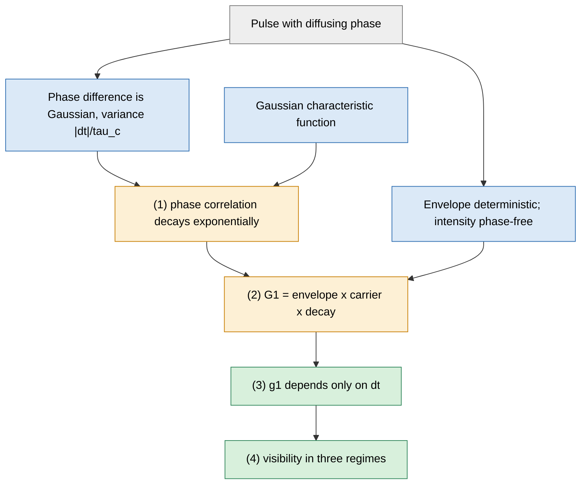

### Derivation

#### Step 1: (1) The phase-correlation factor

A Gaussian random walk (Wiener process) is a Gaussian *process*: for any times, $(\phi(t_1),\phi(t_2))$ are jointly Gaussian. Then $X\equiv\phi(t_2)-\phi(t_1)$ is a linear combination with $\mathbf w=(-1,1)$, hence Gaussian by (G2), with

$$
\left\langle X\right\rangle=\left\langle\phi(t_2)\right\rangle-\left\langle\phi(t_1)\right\rangle=0,\qquad \left\langle X^2\right\rangle=\frac{|t_1-t_2|}{\tau_c}.
$$

By (G3),

$$
\left\langle\mathrm{e}^{\mathrm{i}[\phi(t_2)-\phi(t_1)]}\right\rangle=\mathrm{e}^{-\frac12\left\langle X^2\right\rangle}=\exp\!\Big(-\frac{|t_1-t_2|}{2\tau_c}\Big).\qquad\square
$$

Gaussianity is essential: for a non-Gaussian $X$ the cumulant expansion $\ln\left\langle\mathrm{e}^{\mathrm{i}X}\right\rangle=-\tfrac12\left\langle X^2\right\rangle-\tfrac{\mathrm{i}}{6}\kappa_3+\tfrac1{24}\kappa_4+\dots$ has higher cumulants $\kappa_{n\ge3}$, which vanish only for a Gaussian.

#### Step 2: (2) Unnormalised first-order correlation

In $E^*(t_1)E(t_2)$ only the phase is random; the envelope and carrier are deterministic and leave the average:

$$
\begin{aligned}
G^{(1)}(t_1,t_2)&=E_0^2\,\mathrm{e}^{-\frac{t_1^2}{2T^2}}\mathrm{e}^{-\frac{t_2^2}{2T^2}}\;\mathrm{e}^{+\mathrm{i}\omega_0t_1}\mathrm{e}^{-\mathrm{i}\omega_0t_2}\;\left\langle\mathrm{e}^{-\mathrm{i}\phi(t_1)}\mathrm{e}^{\mathrm{i}\phi(t_2)}\right\rangle\\
&=E_0^2\,\exp\!\Big(-\frac{t_1^2+t_2^2}{2T^2}\Big)\,\mathrm{e}^{-\mathrm{i}\omega_0(t_2-t_1)}\,\exp\!\Big(-\frac{|t_2-t_1|}{2\tau_c}\Big).
\end{aligned}
$$

#### Step 3: (3) Normalised correlation

At equal times the random phase cancels identically, $|E(t)|^2=E_0^2\mathrm{e}^{-t^2/T^2}$, so $\left\langle|E(t)|^2\right\rangle=E_0^2\mathrm{e}^{-t^2/T^2}$ (equivalently $G^{(1)}(t,t)$). Then $\sqrt{\left\langle|E(t_1)|^2\right\rangle\left\langle|E(t_2)|^2\right\rangle}=E_0^2\exp\!\big(-\frac{t_1^2+t_2^2}{2T^2}\big)$, which is exactly the envelope factor of $G^{(1)}$. Dividing,

$$
\boxed{g^{(1)}(t_1,t_2)=\mathrm{e}^{-\mathrm{i}\omega_0\Delta t}\,\mathrm{e}^{-|\Delta t|/(2\tau_c)},\qquad \Delta t=t_2-t_1 .}
$$

The deterministic envelope cancels because it factorises, $|E(t)|\propto f(t)$, and $g^{(1)}$ is normalised by the same $f(t_1)f(t_2)$; only the *random* part — here the phase — survives. $g^{(1)}$ is stationary even though the field is not.

#### Step 4: (4) Visibility at $\Delta t=T$

$|g^{(1)}|=\mathrm{e}^{-T/(2\tau_c)}$:

-   $\tau_c\gg T$: $|g^{(1)}|\simeq1-\frac{T}{2\tau_c}\to1$. The phase barely diffuses within one pulse; the pulse interferes with its delayed copy with near-perfect contrast (nearly transform-limited pulse).

-   $\tau_c\sim T$: e.g. $\tau_c=T$ gives $\mathrm{e}^{-1/2}\approx0.61$; partially coherent, the spectrum is broadened beyond the transform limit $\sim1/T$.

-   $\tau_c\ll T$: $|g^{(1)}|\approx\mathrm{e}^{-T/(2\tau_c)}\to0$; the phase decorrelates many times within a pulse; fringes vanish; the linewidth $\sim1/\tau_c$ is set by the noise, not by the pulse length.

The decay $|g^{(1)}|=\mathrm{e}^{-|\Delta t|/2\tau_c}$ is the Fourier transform partner of a Lorentzian line (Additional problem 2.A).

#### Step 5: What an interferometer with a slow detector records

$g^{(1)}(t_1,t_2)$ is a *local* quantity. A Michelson interferometer with delay $\Delta t$ followed by a detector that integrates over the whole pulse measures $\int\mathrm{d}t\,|E(t)+E(t+\Delta t)|^2$, whose fringe visibility is

$$
V(\Delta t)=\frac{2\big|\int\mathrm{d}t\,G^{(1)}(t,t+\Delta t)\big|}{\int\mathrm{d}t\,\left\langle|E(t)|^2\right\rangle+\int\mathrm{d}t\,\left\langle|E(t+\Delta t)|^2\right\rangle}
=\frac{\int\mathrm{d}t\,\mathrm{e}^{-[t^2+(t+\Delta t)^2]/(2T^2)}}{\int\mathrm{d}t\,\mathrm{e}^{-t^2/T^2}}\;\mathrm{e}^{-|\Delta t|/2\tau_c}.
$$

Using $t^2+(t+\Delta t)^2=2(t+\Delta t/2)^2+\Delta t^2/2$ and shifting the integration variable, the ratio of integrals is $\mathrm{e}^{-\Delta t^2/(4T^2)}$, so $V(\Delta t)=\mathrm{e}^{-\Delta t^2/(4T^2)}\mathrm{e}^{-|\Delta t|/2\tau_c}$. At $\Delta t=T$ the pulse overlap alone gives $\mathrm{e}^{-1/4}\approx0.78$ even for perfect phase coherence. The envelope “drops out” of $g^{(1)}$, not out of the measured visibility.

> [!success] Result
>
> $\left\langle\mathrm{e}^{\mathrm{i}[\phi(t_2)-\phi(t_1)]}\right\rangle=\mathrm{e}^{-|\Delta t|/2\tau_c}$; $G^{(1)}=E_0^2\mathrm{e}^{-(t_1^2+t_2^2)/2T^2}\mathrm{e}^{-\mathrm{i}\omega_0\Delta t}\mathrm{e}^{-|\Delta t|/2\tau_c}$; $g^{(1)}=\mathrm{e}^{-\mathrm{i}\omega_0\Delta t}\mathrm{e}^{-|\Delta t|/2\tau_c}$; $|g^{(1)}(\Delta t=T)|=\mathrm{e}^{-T/2\tau_c}$: $\approx1$, $\approx0.61$, $\approx0$ in the three regimes.
>

> [!warning] Check of your handwritten fragments
>
> Your $G^{(1)}$, $g^{(1)}$ and $|g^{(1)}|=\mathrm{e}^{-T/2\tau_c}$ are correct. One point to state explicitly in a solution: the step $\left\langle\mathrm{e}^{\mathrm{i}X}\right\rangle=\mathrm{e}^{-\left\langle X^2\right\rangle/2}$ needs $X=\phi(t_2)-\phi(t_1)$ to be Gaussian, which follows from $\phi$ being a Gaussian *process* (joint Gaussianity), not merely from each $\phi(t)$ being Gaussian.
>

## Problem 2.2: Hanbury Brown–Twiss stellar intensity interferometry

> [!quote] Problem statement
>
> A distant star is an extended, incoherent, chaotic thermal source. Telescopes $T_1,T_2$ with baseline $d$ perpendicular to the line of sight, narrow filters (centre $\nu_0$, width $\Delta\nu$), fast detectors; fields $E_1(t),E_2(t)$. (1) Show $\left\langle I_1I_2\right\rangle=\left\langle I_1\right\rangle\left\langle I_2\right\rangle+|\left\langle E_1^*E_2\right\rangle|^2$. (2) Show $g^{(2)}(d,0)=1+|\gamma_{12}(d)|^2$, $\gamma_{12}=\left\langle E_1^*E_2\right\rangle/\sqrt{\left\langle I_1\right\rangle\left\langle I_2\right\rangle}$. (VCZ-1) Uniform 1D line source of angular width $\theta$: show $\gamma_{12}=\operatorname{sinc}(\pi d\theta/\lambda_0)$. (VCZ-2) Uniform disk of angular diameter $\theta$: $\gamma_{12}=2J_1(x)/x$, $x=\pi d\theta/\lambda_0$; sketch $g^{(2)}(d,0)$; what happens at $d=0$? (Sirius-1) $\lambda_0=438$ nm, first minimum $g^{(2)}=1$ at $d_0=9.2$ m, first zero of $J_1$ at $3.832$: find $\theta$ in rad and arcsec. (Sirius-2) With atmospheric phases $E_j\to E_j\mathrm{e}^{\mathrm{i}\phi_j(t)}$, show why HBT is immune while a Michelson amplitude interferometer is degraded.
>

> [!question] Conceptual challenges (answer each before reading on)
>
> 1.  Why is the field of a chaotic source a *complex Gaussian* random variable, and why is $\left\langle E_1E_2\right\rangle=0$? $\to$ Step 1
>
> 2.  How does Wick’s theorem turn a four-field average into products of two-field averages? $\to$ Step 2, toolbox (G4)
>
> 3.  What does “incoherent source” mean mathematically? $\to$ Step 4
>
> 4.  Which geometric approximation turns propagation into a Fourier transform (far field), and what is the role of the narrow filter? $\to$ Steps 4, 5
>
> 5.  How does one integrate $\mathrm{e}^{\mathrm{i}\mathbf k\cdot\boldsymbol\psi}$ over a disk, and where does $J_1$ come from? $\to$ Step 6
>
> 6.  Why can a measurement that never compares phases still determine a size? $\to$ Step 9
>

### Concept map

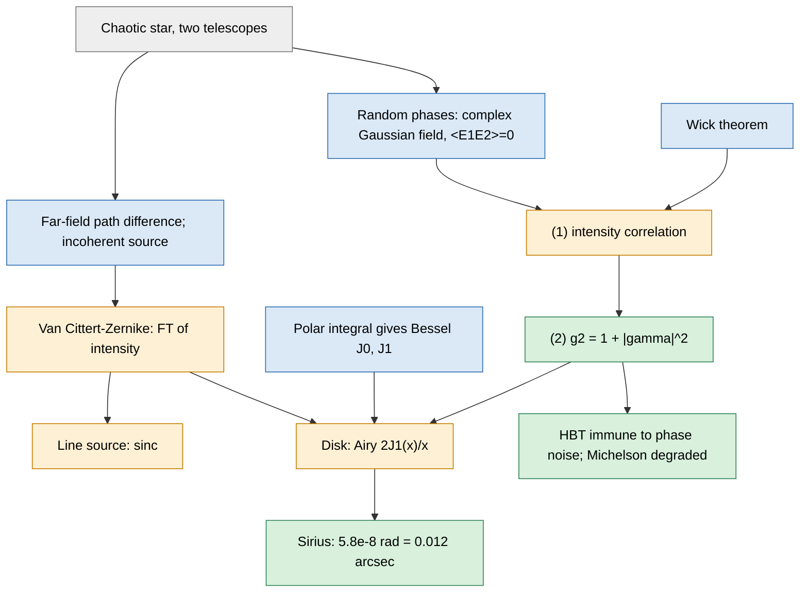

### Derivation

#### Step 1: Chaotic light is a circular complex Gaussian field

Model the field at telescope $j$ as the sum of contributions of very many independent emitters (atoms on the stellar surface), $E_j(t)=\sum_{s}a_{js}\mathrm{e}^{\mathrm{i}\varphi_s}$, where the $a_{js}$ are the (deterministic, filtered) propagation amplitudes from emitter $s$ to telescope $j$ and the $\varphi_s$ are independent phases uniformly distributed on $[0,2\pi)$. Two consequences:

1.  *Gaussianity*: the real and imaginary parts of $E_1,E_2$ are sums of many independent bounded terms; by the central limit theorem they are jointly Gaussian with zero mean, $\left\langle\mathrm{e}^{\mathrm{i}\varphi_s}\right\rangle=0$.

2.  *Phase insensitivity*: $\left\langle E_1E_2\right\rangle=\sum_{s,s'}a_{1s}a_{2s'}\left\langle\mathrm{e}^{\mathrm{i}(\varphi_s+\varphi_{s'})}\right\rangle=0$, since for $s\neq s'$ the average factorises into $\left\langle\mathrm{e}^{\mathrm{i}\varphi_s}\right\rangle\left\langle\mathrm{e}^{\mathrm{i}\varphi_{s'}}\right\rangle=0$, and for $s=s'$, $\left\langle\mathrm{e}^{2\mathrm{i}\varphi_s}\right\rangle=\frac{1}{2\pi}\int_0^{2\pi}\mathrm{e}^{2\mathrm{i}\varphi}\mathrm{d}\varphi=0$. Similarly $\left\langle E_j^2\right\rangle=0$. By contrast $\left\langle E_1^*E_2\right\rangle=\sum_s a_{1s}^*a_{2s}\neq0$: only the $s=s'$ terms survive.

We assume stationarity and ergodicity, so the time average $\overline{(\cdot)}$ recorded by the correlator equals the ensemble average $\left\langle\cdot\right\rangle$, and detectors faster than the coherence time $1/\Delta\nu$ (the general case is discussed at the end).

#### Step 2: (1) The intensity correlation

With $I_j=E_j^*E_j$, apply (G4) to $z_1=E_1^*$, $z_2=E_1$, $z_3=E_2^*$, $z_4=E_2$:

$$
\left\langle I_1I_2\right\rangle=\left\langle E_1^*E_1\right\rangle\left\langle E_2^*E_2\right\rangle+\left\langle E_1^*E_2^*\right\rangle\left\langle E_1E_2\right\rangle+\left\langle E_1^*E_2\right\rangle\left\langle E_1E_2^*\right\rangle.
$$

The middle term vanishes by Step 1(ii) ($\left\langle E_1^*E_2^*\right\rangle=\left\langle E_1E_2\right\rangle^*=0$), and $\left\langle E_1E_2^*\right\rangle=\left\langle E_1^*E_2\right\rangle^*$. Therefore

$$
\boxed{\left\langle I_1I_2\right\rangle=\left\langle I_1\right\rangle\left\langle I_2\right\rangle+|\left\langle E_1^*E_2\right\rangle|^2 .}
$$

This is the Siegert relation; it holds only for Gaussian (chaotic) light.

#### Step 3: (2) Normalised second-order correlation

Define $g^{(2)}(d,\tau)=\dfrac{\left\langle I_1(t)I_2(t+\tau)\right\rangle}{\left\langle I_1\right\rangle\left\langle I_2\right\rangle}$. At $\tau=0$, dividing the result of Step 2 by $\left\langle I_1\right\rangle\left\langle I_2\right\rangle$:

$$
g^{(2)}(d,0)=1+\frac{|\left\langle E_1^*E_2\right\rangle|^2}{\left\langle I_1\right\rangle\left\langle I_2\right\rangle}=1+|\gamma_{12}(d)|^2 .
$$

The “1” is the uncorrelated product of mean intensities; the excess is the squared modulus of the spatial coherence. HBT measures $|\gamma_{12}|$ but not its phase.

#### Step 4: (VCZ-1) Geometry and incoherence

Put the star at distance $R$ along the optical axis and describe a point of the source by its angular coordinate $\psi$ (transverse position $R\psi$). Let telescope $j$ sit at transverse position $x_j$, with $x_2-x_1=d$. The distance from source point $\psi$ to telescope $j$ is

$$
r_j(\psi)=\sqrt{R^2+(x_j-R\psi)^2}\simeq R+\frac{(x_j-R\psi)^2}{2R}=R+\frac{x_j^2}{2R}-x_j\psi+\frac{R\psi^2}{2},
$$

using $\sqrt{1+\epsilon}\simeq1+\epsilon/2$ for $\epsilon=(x_j-R\psi)^2/R^2\ll1$. Then

$$
r_2(\psi)-r_1(\psi)=\underbrace{\frac{x_2^2-x_1^2}{2R}}_{\equiv\Phi_0/k}-d\,\psi .
$$

The $\psi$-independent part gives a common phase $\Phi_0$; choosing $x_{1,2}=\mp d/2$ makes it zero. For a quasi-monochromatic field ($k=2\pi/\lambda_0$, narrow filter) let $A(\psi)\,\mathrm{d}\psi$ be the complex amplitude emitted by the strip $[\psi,\psi+\mathrm{d}\psi]$. A spherical wave gives

$$
E_j=\int\mathrm{d}\psi\,A(\psi)\frac{\mathrm{e}^{\mathrm{i}kr_j(\psi)}}{r_j(\psi)}\simeq\frac1R\int\mathrm{d}\psi\,A(\psi)\,\mathrm{e}^{\mathrm{i}kr_j(\psi)}
$$

(in the slowly varying $1/r_j$ we replace $r_j\to R$). An *incoherent* source has $\left\langle A^*(\psi)A(\psi')\right\rangle=\mathcal I(\psi)\,\delta(\psi-\psi')$ with $\mathcal I(\psi)\ge0$ the angular intensity distribution: different points have independent random phases (Step 1(ii) applied to source points). Then

$$
\left\langle E_1^*E_2\right\rangle=\frac1{R^2}\int\!\!\int\mathrm{d}\psi\,\mathrm{d}\psi'\,\left\langle A^*(\psi)A(\psi')\right\rangle\,\mathrm{e}^{-\mathrm{i}kr_1(\psi)+\mathrm{i}kr_2(\psi')}
=\frac{\mathrm{e}^{\mathrm{i}\Phi_0}}{R^2}\int\mathrm{d}\psi\;\mathcal I(\psi)\,\mathrm{e}^{-\mathrm{i}kd\psi},
$$

and in the same way $\left\langle I_j\right\rangle=\left\langle E_j^*E_j\right\rangle=\frac{1}{R^2}\int\mathrm{d}\psi\,\mathcal I(\psi)$. So

$$
\gamma_{12}(d)=\mathrm{e}^{\mathrm{i}\Phi_0}\,\frac{\int\mathrm{d}\psi\,\mathcal I(\psi)\,\mathrm{e}^{-\mathrm{i}kd\psi}}{\int\mathrm{d}\psi\,\mathcal I(\psi)}:
$$

the van Cittert–Zernike theorem — the normalised Fourier transform of the angular intensity distribution, evaluated at spatial frequency $kd=2\pi d/\lambda_0$.

#### Step 5: Uniform line source

$\mathcal I(\psi)=\mathcal I_0$ for $|\psi|\le\theta/2$, zero otherwise:

$$
\int_{-\theta/2}^{\theta/2}\mathrm{d}\psi\,\mathrm{e}^{-\mathrm{i}kd\psi}=\frac{\mathrm{e}^{-\mathrm{i}kd\theta/2}-\mathrm{e}^{\mathrm{i}kd\theta/2}}{-\mathrm{i}kd}=\frac{2\sin(kd\theta/2)}{kd}=\theta\,\frac{\sin(kd\theta/2)}{kd\theta/2},
$$

and the normalisation is $\mathcal I_0\theta$. With $kd\theta/2=\pi d\theta/\lambda_0$ (and $\Phi_0=0$ for symmetric telescopes):

$$
\boxed{\gamma_{12}(d)=\operatorname{sinc}\!\Big(\frac{\pi d\theta}{\lambda_0}\Big),\qquad \operatorname{sinc}u=\frac{\sin u}{u}.}
$$

Validity: the narrow filter makes the source quasi-monochromatic, so a single $k$ may be used; this requires the path differences $|r_2-r_1|\lesssim d\theta$ to be much shorter than the coherence length $c/\Delta\nu$. The far-field expansion requires $R\gg d^2/\lambda_0$ and $R\gg(R\theta)^2/\lambda_0$ (the neglected quadratic terms produce phases $\ll1$ or common phases), trivially true for a star.

#### Step 6: (VCZ-2) Uniform disk: where $J_1$ comes from

Now $\boldsymbol\psi=(\psi_x,\psi_y)$ is a 2D angular position and the baseline vector $\mathbf d$ is along $x$. The same derivation gives $\gamma_{12}=\int\mathrm{d}^2\psi\,\mathcal I(\boldsymbol\psi)\mathrm{e}^{-\mathrm{i}k\mathbf d\cdot\boldsymbol\psi}/\int\mathrm{d}^2\psi\,\mathcal I$. Use polar coordinates $\boldsymbol\psi=\rho(\cos\varphi,\sin\varphi)$, $\mathbf d\cdot\boldsymbol\psi=d\rho\cos\varphi$, disk radius $\theta/2$:

$$
\int_{\rm disk}\mathrm{d}^2\psi\,\mathrm{e}^{-\mathrm{i}kd\rho\cos\varphi}=\int_0^{\theta/2}\rho\,\mathrm{d}\rho\int_0^{2\pi}\mathrm{d}\varphi\,\mathrm{e}^{-\mathrm{i}kd\rho\cos\varphi}=2\pi\int_0^{\theta/2}\rho\,J_0(kd\rho)\,\mathrm{d}\rho ,
$$

where we *define* $J_0(u)=\frac1{2\pi}\int_0^{2\pi}\mathrm{e}^{\mathrm{i}u\cos\varphi}\mathrm{d}\varphi$ (the sign of the exponent is irrelevant: $\varphi\to\varphi+\pi$ flips it).

*Series for $J_0$.* Expand the exponential: $J_0(u)=\sum_n\frac{(\mathrm{i}u)^n}{n!}\frac{1}{2\pi}\int_0^{2\pi}\cos^n\varphi\,\mathrm{d}\varphi$. Odd $n$ integrate to zero (by $\varphi\to\varphi+\pi$). For $n=2m$, writing $\cos\varphi=(\mathrm{e}^{\mathrm{i}\varphi}+\mathrm{e}^{-\mathrm{i}\varphi})/2$ and keeping only the term of the binomial expansion with zero net frequency, $\frac{1}{2\pi}\int\cos^{2m}\varphi\,\mathrm{d}\varphi=\binom{2m}{m}4^{-m}$. Hence

$$
J_0(u)=\sum_{m\ge0}\frac{(-1)^mu^{2m}}{(2m)!}\cdot\frac{(2m)!}{(m!)^24^m}=\sum_{m\ge0}\frac{(-1)^m}{(m!)^2}\Big(\frac u2\Big)^{2m}.
$$

*Define* $J_1(u)=\sum_{m\ge0}\frac{(-1)^m}{m!(m+1)!}\big(\frac u2\big)^{2m+1}$ (the standard first-order Bessel function). Differentiating term by term,

$$
\frac{\mathrm{d}}{\mathrm{d}u}\big[uJ_1(u)\big]=\sum_m\frac{(-1)^m(2m+2)u^{2m+1}}{2^{2m+1}m!(m+1)!}=\sum_m\frac{(-1)^mu^{2m+1}}{4^m(m!)^2}=u\,J_0(u),
$$

because $(2m+2)/(2(m+1)!)=1/m!$. Therefore $\int_0^{U}u\,J_0(u)\,\mathrm{d}u=U J_1(U)$. Substituting $u=kd\rho$, $U=kd\theta/2$:

$$
2\pi\int_0^{\theta/2}\rho J_0(kd\rho)\,\mathrm{d}\rho=\frac{2\pi}{(kd)^2}\,U J_1(U),\qquad \text{area}=\pi(\theta/2)^2=\frac{\pi U^2}{(kd)^2}.
$$

Dividing,

$$
\boxed{\gamma_{12}(d)=\frac{2J_1(x)}{x},\qquad x=\frac{kd\theta}{2}=\frac{\pi d\theta}{\lambda_0}.}
$$

Since $J_1(x)=\frac x2-\frac{x^3}{16}+\dots$, $\gamma_{12}\to1$ as $d\to0$.

#### Step 7: Sketch of $g^{(2)}(d,0)$

![[hbt_g2.png|600]]

$g^{(2)}(d,0)=1+[2J_1(x)/x]^2$ starts at $2$ for $d=0$, falls to $1$ at the first zero $x=3.832$, and has weak secondary maxima ($1.0175$ at $x\approx5.14$, then smaller). At $d=0$ the two detectors see the *same* chaotic field, $\gamma_{12}=1$, and $g^{(2)}=2$: photon bunching of thermal light, $\left\langle I^2\right\rangle=2\left\langle I\right\rangle^2$ (the intensity of a circular Gaussian field is exponentially distributed).

#### Step 8: (Sirius-1) Angular diameter

$g^{(2)}=1$ first when $J_1(x)=0$, i.e. $x=\pi d_0\theta/\lambda_0=3.832$:

$$
\theta=\frac{3.832\,\lambda_0}{\pi d_0}=\frac{3.832\times438\times10^{-9}\,\mathrm m}{\pi\times9.2\,\mathrm m}=5.81\times10^{-8}\ \mathrm{rad}.
$$

With $1\ \mathrm{rad}=\frac{180}{\pi}\cdot3600''=206265''$: $\theta=5.81\times10^{-8}\times206265''=0.0120''\approx12$ mas. (Equivalently, $\theta=1.22\lambda_0/d_0$, the Rayleigh-type criterion.)

#### Step 9: (Sirius-2) Immunity to atmospheric phase noise

With $E_j\to E_j\mathrm{e}^{\mathrm{i}\phi_j(t)}$ (real $\phi_j$):

-   *HBT.* $I_j=|E_j\mathrm{e}^{\mathrm{i}\phi_j}|^2=|E_j|^2$ *exactly*, at every instant; so $\left\langle I_1I_2\right\rangle$, $\left\langle I_j\right\rangle$ and $g^{(2)}(d,0)$ are unchanged whatever the statistics of $\phi_j$.

-   *Michelson.* The combined intensity is $\left\langle|E_1\mathrm{e}^{\mathrm{i}\phi_1}+E_2\mathrm{e}^{\mathrm{i}\phi_2}|^2\right\rangle=\left\langle I_1\right\rangle+\left\langle I_2\right\rangle+2\operatorname{Re}\left\langle E_1^*E_2\,\mathrm{e}^{\mathrm{i}(\phi_2-\phi_1)}\right\rangle$. Atmosphere and star are independent, so the last average factorises: $2\operatorname{Re}\big[\left\langle E_1^*E_2\right\rangle\left\langle\mathrm{e}^{\mathrm{i}(\phi_2-\phi_1)}\right\rangle\big]$. For Gaussian turbulence with $\left\langle(\phi_2-\phi_1)^2\right\rangle=\sigma_\phi^2$, (G3) gives $\left\langle\mathrm{e}^{\mathrm{i}(\phi_2-\phi_1)}\right\rangle=\mathrm{e}^{-\sigma_\phi^2/2}$: the fringe term, which carries $\gamma_{12}$, is suppressed by $\mathrm{e}^{-\sigma_\phi^2/2}$. For optical wavelengths over metre baselines $\sigma_\phi\gg1$ rad and the fringes wash out.

Physically: the phase noise enters linearly in the field, so it enters the amplitude interference term, but it cancels in $|E|^2$. HBT is sensitive only to path fluctuations comparable to $c/\Delta\nu_{\rm el}$ (the electronic bandwidth, $\sim$ metres), not to the optical wavelength.

> [!success] Result
>
> \(1\) $\left\langle I_1I_2\right\rangle=\left\langle I_1\right\rangle\left\langle I_2\right\rangle+|\left\langle E_1^*E_2\right\rangle|^2$ (Wick + $\left\langle E_1E_2\right\rangle=0$). (2) $g^{(2)}(d,0)=1+|\gamma_{12}|^2$. Line source: $\gamma_{12}=\operatorname{sinc}(\pi d\theta/\lambda_0)$; disk: $2J_1(x)/x$; $g^{(2)}(0,0)=2$. Sirius: $\theta=5.81\times10^{-8}$ rad $=0.012''$. HBT is immune to atmospheric phases because $|E\mathrm{e}^{\mathrm{i}\phi}|^2=|E|^2$; Michelson fringes are reduced by $\left\langle\mathrm{e}^{\mathrm{i}\Delta\phi}\right\rangle=\mathrm{e}^{-\sigma_\phi^2/2}$.
>

> [!warning] Check of your handwritten fragments
>
> Your numbers ($\theta\approx5.8\times10^{-8}$ rad $\approx0.012''=12$ mas), the VCZ integral and the Wick counting ($24/8=3$ distinct pairings) are correct. Two additions for a complete solution. (i) The vanishing of $\left\langle E_1E_2\right\rangle$ is not a consequence of Gaussianity; it is the separate “circularity” property from random emitter phases (Step 1(ii)). (ii) Real detectors are not faster than $1/\Delta\nu$: with resolving time $\tau_d\gg1/\Delta\nu$ the measured excess is reduced to $|\gamma_{12}|^2\times\mathcal O(1/(\Delta\nu\,\tau_d))$, which is why the historical HBT signal was tiny. Historically, Hanbury Brown and Twiss (1956) obtained about $6.8$ mas for Sirius (confidence $\sim$<!-- -->75% on the exact figure) with baselines only up to $\sim$<!-- -->9 m; the problem’s “first zero at 9.2 m” is a constructed number.
>

## Additional problem 2.A: Spectrum and intensity statistics of a phase-diffusing laser

> [!quote] Problem statement
>
> A continuous-wave laser field $E(t)=E_0\mathrm{e}^{-\mathrm{i}\omega_0t+\mathrm{i}\phi(t)}$ has the phase diffusion of Problem 2.1. (i) Using the Wiener–Khinchin theorem (derive it), find the power spectrum $S(\omega)$ and its full width at half maximum. (ii) Find $g^{(2)}(\tau)$ and compare with chaotic light having the same $g^{(1)}(\tau)$.
>

> [!question] Conceptual challenges (answer each before reading on)
>
> 1.  Why is the spectrum the Fourier transform of $G^{(1)}(\tau)$? $\to$ Step 1
>
> 2.  Can two fields have the same $g^{(1)}$ but different $g^{(2)}$? $\to$ Step 3
>

### Concept map

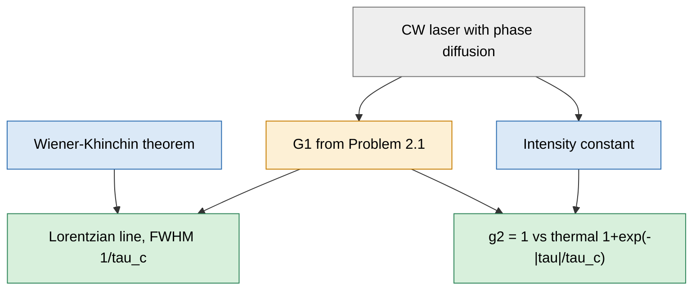

### Derivation

#### Step 1: Wiener–Khinchin

Let $\tilde E_{\mathcal T}(\omega)=\int_{-\mathcal T/2}^{\mathcal T/2}\mathrm{d}t\,E(t)\mathrm{e}^{\mathrm{i}\omega t}$ be the Fourier transform over an observation window $\mathcal T$. For a stationary field with $G^{(1)}(\tau)=\left\langle E^*(t)E(t+\tau)\right\rangle$,

$$
\left\langle|\tilde E_{\mathcal T}(\omega)|^2\right\rangle=\int\!\!\int_{-\mathcal T/2}^{\mathcal T/2}\mathrm{d}t\,\mathrm{d}t'\,G^{(1)}(t'-t)\,\mathrm{e}^{\mathrm{i}\omega(t'-t)}=\int_{-\mathcal T}^{\mathcal T}\mathrm{d}\tau\,(\mathcal T-|\tau|)\,G^{(1)}(\tau)\mathrm{e}^{\mathrm{i}\omega\tau},
$$

where $\tau=t'-t$ and $\mathcal T-|\tau|$ is the length of the line $t'-t=\tau$ inside the square. For $\mathcal T\gg\tau_c$, $\mathcal T-|\tau|\to\mathcal T$ wherever $G^{(1)}$ is non-negligible, so the power per unit time and per unit angular frequency is

$$
S(\omega)\equiv\lim_{\mathcal T\to\infty}\frac{\left\langle|\tilde E_{\mathcal T}(\omega)|^2\right\rangle}{2\pi\mathcal T}=\frac{1}{2\pi}\int_{-\infty}^{\infty}\mathrm{d}\tau\,G^{(1)}(\tau)\,\mathrm{e}^{\mathrm{i}\omega\tau}.
$$

#### Step 2: Lorentzian line

From Problem 2.1 with $T\to\infty$, $G^{(1)}(\tau)=E_0^2\mathrm{e}^{-\mathrm{i}\omega_0\tau}\mathrm{e}^{-|\tau|/2\tau_c}$. With $\delta=\omega-\omega_0$ and $\Gamma=1/(2\tau_c)$:

$$
S(\omega)=\frac{E_0^2}{2\pi}\Big[\int_0^\infty\mathrm{e}^{(\mathrm{i}\delta-\Gamma)\tau}\mathrm{d}\tau+\int_0^\infty\mathrm{e}^{(-\mathrm{i}\delta-\Gamma)\tau}\mathrm{d}\tau\Big]
=\frac{E_0^2}{2\pi}\Big[\frac{1}{\Gamma-\mathrm{i}\delta}+\frac1{\Gamma+\mathrm{i}\delta}\Big]=\frac{E_0^2}{\pi}\,\frac{\Gamma}{\delta^2+\Gamma^2}.
$$

Half maximum at $\delta=\pm\Gamma$: FWHM $\Delta\omega=2\Gamma=1/\tau_c$ (i.e. $\Delta\nu=1/(2\pi\tau_c)$). Check: $\int S\,\mathrm{d}\omega=E_0^2=G^{(1)}(0)$.

#### Step 3: Intensity correlations

$I(t)=|E(t)|^2=E_0^2$ is constant, so $g^{(2)}(\tau)=\left\langle I(t)I(t+\tau)\right\rangle/\left\langle I\right\rangle^2=1$ for all $\tau$. Chaotic light with the same $g^{(1)}(\tau)$ obeys the Siegert relation (Problem 2.2, Step 2) $g^{(2)}(\tau)=1+|g^{(1)}(\tau)|^2=1+\mathrm{e}^{-|\tau|/\tau_c}$, bunched with $g^{(2)}(0)=2$. Identical spectra, different photon statistics: first-order coherence does not determine second-order coherence unless the field is known to be Gaussian.

> [!success] Result
>
> $S(\omega)=\dfrac{E_0^2}{\pi}\dfrac{1/(2\tau_c)}{(\omega-\omega_0)^2+1/(4\tau_c^2)}$, FWHM $1/\tau_c$; $g^{(2)}(\tau)=1$ for the laser vs. $1+\mathrm{e}^{-|\tau|/\tau_c}$ for thermal light with the same spectrum.
>

## Additional problem 2.B: Intensity interferometry of a binary star

> [!quote] Problem statement
>
> Model a binary star as two unresolved point sources at angular positions $\pm\theta_s/2$ along the baseline direction, with mean intensities $I_A$ and $I_B$. (i) Find $g^{(2)}(d,0)$. (ii) For $I_A=I_B$, $\lambda_0=500$ nm and $\theta_s=0.1''$, find the smallest baseline at which the excess correlation vanishes. (iii) What can HBT not tell you about the binary?
>

> [!question] Conceptual challenges (answer each before reading on)
>
> 1.  What is the angular intensity distribution of two point sources? $\to$ Step 1
>
> 2.  Does HBT measure $\gamma_{12}$ or only $|\gamma_{12}|$, and what information is lost? $\to$ Step 3
>

### Concept map

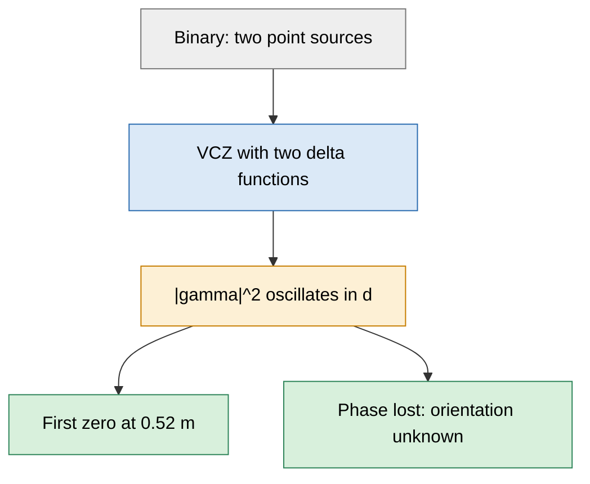

### Derivation

#### Step 1: Van Cittert–Zernike for two points

$\mathcal I(\psi)=I_A\delta(\psi-\theta_s/2)+I_B\delta(\psi+\theta_s/2)$. The VCZ formula of Problem 2.2 gives

$$
\gamma_{12}=\frac{I_A\mathrm{e}^{-\mathrm{i}kd\theta_s/2}+I_B\mathrm{e}^{\mathrm{i}kd\theta_s/2}}{I_A+I_B},\qquad
|\gamma_{12}|^2=\frac{I_A^2+I_B^2+2I_AI_B\cos(kd\theta_s)}{(I_A+I_B)^2},
$$

using $|z_1+z_2|^2=|z_1|^2+|z_2|^2+2\operatorname{Re}(z_1^*z_2)$. Hence $g^{(2)}(d,0)=1+|\gamma_{12}|^2$, periodic in $d$ with period $\lambda_0/\theta_s$, oscillating between $1+1$ and $1+\big(\frac{I_A-I_B}{I_A+I_B}\big)^2$.

#### Step 2: Equal components

For $I_A=I_B$, $|\gamma_{12}|=|\cos(\pi d\theta_s/\lambda_0)|$, zero first at $d=\lambda_0/(2\theta_s)$. With $\theta_s=0.1/206265=4.85\times10^{-7}$ rad: $d=5\times10^{-7}/(2\times4.85\times10^{-7})\,\mathrm m\approx0.52$ m.

#### Step 3: What is lost

$g^{(2)}$ depends only on $|\gamma_{12}|^2$, which is even in $\theta_s$ and symmetric under $I_A\leftrightarrow I_B$. HBT therefore cannot tell which component is brighter or on which side it lies (the phase of $\gamma_{12}$, the “phase problem”); it yields separation and brightness ratio only.

> [!success] Result
>
> $g^{(2)}(d,0)=1+\dfrac{I_A^2+I_B^2+2I_AI_B\cos(2\pi d\theta_s/\lambda_0)}{(I_A+I_B)^2}$; for equal stars the excess first vanishes at $d=\lambda_0/2\theta_s\approx0.52$ m; orientation/brighter-component information is lost with the phase of $\gamma_{12}$.
>

# Homework 3 — squeezed states and phase-space pictures

## Prerequisites for the whole set

> [!note] Prerequisite (derived here, used later)
>
> **(S1) Squeeze operator is unitary.** $\hat S(\xi)=\mathrm{e}^{\hat G}$ with $\hat G=\tfrac12(\xi^*\hat a^2-\xi\hat a^{\dagger2})$. Then $\hat G^\dagger=\tfrac12(\xi\hat a^{\dagger2}-\xi^*\hat a^2)=-\hat G$, so $\hat S^\dagger=\mathrm{e}^{-\hat G}=\hat S^{-1}$, and $\hat S(\xi)^\dagger=\hat S(-\xi)$.
>
> **(S2) Bogoliubov transformation.** Needed commutators: $[\hat a^{\dagger2},\hat a]=\hat a^\dagger[\hat a^\dagger,\hat a]+[\hat a^\dagger,\hat a]\hat a^\dagger=-2\hat a^\dagger$ and $[\hat a^2,\hat a^\dagger]=2\hat a$. Hence
>
> $$
> [\hat G,\hat a]=-\tfrac{\xi}{2}[\hat a^{\dagger 2},\hat a]=\xi\hat a^\dagger,\qquad [\hat G,\hat a^\dagger]=\tfrac{\xi^*}{2}[\hat a^2,\hat a^\dagger]=\xi^*\hat a .
> $$
>
> Let $\hat a(s)=\mathrm{e}^{-s\hat G}\hat a\,\mathrm{e}^{s\hat G}$ and $\hat a^\dagger(s)$ its adjoint. Differentiating, $\frac{\mathrm{d}}{\mathrm{d}s}\hat a(s)=\mathrm{e}^{-s\hat G}[\hat a,\hat G]\mathrm{e}^{s\hat G}=-\xi\,\hat a^\dagger(s)$ and $\frac{\mathrm{d}}{\mathrm{d}s}\hat a^\dagger(s)=-\xi^*\hat a(s)$. Therefore $\frac{\mathrm{d}^2}{\mathrm{d}s^2}\hat a(s)=|\xi|^2\hat a(s)=r^2\hat a(s)$, with initial data $\hat a(0)=\hat a$, $\hat a'(0)=-\xi\hat a^\dagger$. The solution is $\hat a(s)=\hat a\cosh(rs)-\frac{\xi}{r}\hat a^\dagger\sinh(rs)$, and at $s=1$:
>
> $$
> \boxed{\hat S^\dagger\hat a\hat S=\mu\hat a-\nu\hat a^\dagger,\qquad \hat S\hat a\hat S^\dagger=\mu\hat a+\nu\hat a^\dagger,}\qquad \mu=\cosh r,\ \nu=\mathrm{e}^{\mathrm{i}\theta}\sinh r .
> $$
>
> The second form follows from the first with $\xi\to-\xi$ (i.e. $\nu\to-\nu$), using (S1). Consistency: $[\mu\hat a-\nu\hat a^\dagger,\mu\hat a^\dagger-\nu^*\hat a]=\mu^2-|\nu|^2=1$, as unitarity requires.
>
> **(S3) Displacement.** With $\hat G_\alpha=\alpha\hat a^\dagger-\alpha^*\hat a$, $[\hat G_\alpha,\hat a]=-\alpha$, a number, so the Hadamard series stops (Conventions): $\hat D^\dagger(\alpha)\hat a\hat D(\alpha)=\hat a+\alpha$, $\hat D(\alpha)\hat a\hat D^\dagger(\alpha)=\hat a-\alpha$. Quadratures are shifted by $(\alpha_r,\alpha_i)$, variances unchanged.
>

## Problem 3.1: Squeezed vacuum wave function and Wigner function of a squeezed coherent state

> [!quote] Problem statement
>
> Find the wave function of squeezed vacuum in position representation (e.g. from the eigenvalue equation derived in class). Is it squeezed? Act with a displacement operator, and use the result to calculate the Wigner function of a squeezed coherent state.
>

> [!question] Conceptual challenges (answer each before reading on)
>
> 1.  Which operator annihilates $\hat S(\xi)\left|0\right\rangle$? $\to$ Step 1
>
> 2.  How does that operator look in terms of $\hat x,\hat p$, and then as a differential operator? $\to$ Step 2
>
> 3.  What does a *complex* Gaussian exponent $\mathrm{e}^{-Kx^2}$ mean physically? $\to$ Steps 3, 4
>
> 4.  Why does $\mathrm{e}^{-2\mathrm{i}\alpha_r\hat p}$ translate a wave function, and why does the BCH split of $\hat D$ produce an extra phase? $\to$ Step 5
>
> 5.  How does a displacement act on the Wigner function? $\to$ Step 7
>

### Concept map

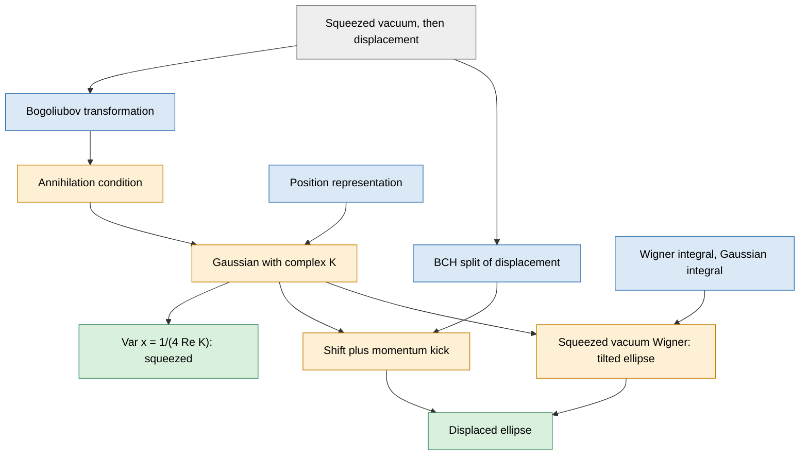

### Derivation

#### Step 1: Annihilation condition

Let $\left|\xi\right\rangle\equiv\hat S(\xi)\left|0\right\rangle$. Since $\hat a\left|0\right\rangle=0$: $0=\hat S\hat a\left|0\right\rangle=\hat S\hat a\hat S^\dagger\hat S\left|0\right\rangle=(\mu\hat a+\nu\hat a^\dagger)\left|\xi\right\rangle$ by (S2).

#### Step 2: Position representation

Insert $\hat a=\hat x+\mathrm{i}\hat p$, $\hat a^\dagger=\hat x-\mathrm{i}\hat p$: $(\mu+\nu)\hat x+\mathrm{i}(\mu-\nu)\hat p$. Project on $\left\langle x\right|$, with $\hat p\to-\tfrac{\mathrm{i}}{2}\partial_x$:

$$
(\mu+\nu)\,x\,\psi_\xi(x)+\frac{\mu-\nu}{2}\,\psi_\xi'(x)=0\quad\Longrightarrow\quad \frac{\psi_\xi'}{\psi_\xi}=-2Kx,\qquad K\equiv\frac{\mu+\nu}{\mu-\nu}
$$

($\mu-\nu\neq0$ because $|\nu|<\mu$). Integrating, $\ln\psi_\xi=-Kx^2+{\rm const}$:

$$
\boxed{\psi_\xi(x)=\mathcal N\,\mathrm{e}^{-Kx^2},\qquad \mathcal N=\Big(\frac{2K_r}{\pi}\Big)^{1/4},}
$$

with $K=K_r+\mathrm{i}K_i$; the normalisation follows from $\int|\psi_\xi|^2\mathrm{d}x=\mathcal N^2\int\mathrm{e}^{-2K_rx^2}\mathrm{d}x=\mathcal N^2\sqrt{\pi/(2K_r)}=1$.

#### Step 3: Real and imaginary parts of $K$

Multiply numerator and denominator by $(\mu-\nu)^*=\mu-\nu^*$ ($\mu$ is real):

$$
K=\frac{(\mu+\nu)(\mu-\nu^*)}{|\mu-\nu|^2}=\frac{\mu^2-|\nu|^2+\mu(\nu-\nu^*)}{|\mu-\nu|^2}=\frac{1+2\mathrm{i}\mu\,\operatorname{Im}\nu}{|\mu-\nu|^2}.
$$

With $|\mu-\nu|^2=\cosh^2r+\sinh^2r-2\cosh r\sinh r\cos\theta=\cosh2r-\sinh2r\cos\theta$ and $2\mu\operatorname{Im}\nu=\sinh2r\sin\theta$:

$$
K_r=\frac{1}{\cosh2r-\sinh2r\cos\theta},\qquad K_i=\frac{\sinh2r\sin\theta}{\cosh2r-\sinh2r\cos\theta}.
$$

Similarly $|K|^2=|\mu+\nu|^2/|\mu-\nu|^2=(\cosh2r+\sinh2r\cos\theta)/(\cosh2r-\sinh2r\cos\theta)$.

#### Step 4: Is it squeezed? Variances

$|\psi_\xi|^2=\mathcal N^2\mathrm{e}^{-2K_rx^2}$ is a Gaussian of variance $\sigma^2$ with $1/(2\sigma^2)=2K_r$:

$$
\operatorname{Var}\hat x=\frac{1}{4K_r}=\frac{\cosh2r-\sinh2r\cos\theta}{4}.
$$

For the momentum, $\hat p\psi_\xi=-\tfrac{\mathrm{i}}2(-2Kx)\psi_\xi=\mathrm{i}Kx\,\psi_\xi$, so $\left\langle\hat p^2\right\rangle=\|\hat p\psi_\xi\|^2=|K|^2\left\langle\hat x^2\right\rangle$ and ($\left\langle\hat x\right\rangle=\left\langle\hat p\right\rangle=0$ by parity of $\psi_\xi$)

$$
\operatorname{Var}\hat p=\frac{|K|^2}{4K_r}=\frac{\cosh2r+\sinh2r\cos\theta}{4}.
$$

For $\theta=0$: $\operatorname{Var}\hat x=\tfrac14\mathrm{e}^{-2r}<\tfrac14$ and $\operatorname{Var}\hat p=\tfrac14\mathrm{e}^{2r}$ — squeezed in $x$, with $\Delta x\Delta p=\tfrac14$ (minimum uncertainty). For general $\theta$, $\operatorname{Var}\hat x\operatorname{Var}\hat p=\frac{1+\sinh^22r\sin^2\theta}{16}>\frac1{16}$: the imaginary part $K_i$ (a “chirp” $\mathrm{e}^{-\mathrm{i}K_ix^2}$, i.e. position-dependent momentum $\left\langle\hat p\right\rangle_{\rm local}=-K_ix$) correlates $x$ and $p$, so the noise ellipse is tilted. To see the squeezing for any $\theta$, use the rotated quadrature $\hat X_\phi=\hat x\cos\phi+\hat p\sin\phi=\tfrac12(\hat a\mathrm{e}^{-\mathrm{i}\phi}+\hat a^\dagger\mathrm{e}^{\mathrm{i}\phi})$. From (S2), $\left\langle\hat a^2\right\rangle_\xi=\left\langle 0\right|(\mu\hat a-\nu\hat a^\dagger)^2\left|0\right\rangle=-\mu\nu$ and $\left\langle\hat a^\dagger\hat a\right\rangle_\xi=\left\langle 0\right|(\mu\hat a^\dagger-\nu^*\hat a)(\mu\hat a-\nu\hat a^\dagger)\left|0\right\rangle=|\nu|^2$, so

$$
\operatorname{Var}\hat X_\phi=\tfrac14\big[\mathrm{e}^{-2\mathrm{i}\phi}\left\langle\hat a^2\right\rangle+\mathrm{e}^{2\mathrm{i}\phi}\left\langle\hat a^{\dagger 2}\right\rangle+2\left\langle\hat a^\dagger\hat a\right\rangle+1\big]=\tfrac14\big[\cosh2r-\sinh2r\cos(\theta-2\phi)\big],
$$

minimal, $=\tfrac14\mathrm{e}^{-2r}$, along $\phi=\theta/2$, and maximal, $\tfrac14\mathrm{e}^{2r}$, along $\phi=\theta/2+\pi/2$. Yes, the state is squeezed, along the axis at angle $\theta/2$; the $x$-wave function itself is narrower than vacuum iff $\cos\theta>\tanh r$.

#### Step 5: Displacement: $\psi_{\alpha,\xi}=\left\langle x\middle|\alpha,\xi\right\rangle$ for $\left|\alpha,\xi\right\rangle=\hat D(\alpha)\hat S(\xi)\left|0\right\rangle$

Exponent: $\alpha\hat a^\dagger-\alpha^*\hat a=\alpha(\hat x-\mathrm{i}\hat p)-\alpha^*(\hat x+\mathrm{i}\hat p)=2\mathrm{i}\alpha_i\hat x-2\mathrm{i}\alpha_r\hat p$. With $\hat A=2\mathrm{i}\alpha_i\hat x$, $\hat B=-2\mathrm{i}\alpha_r\hat p$: $[\hat A,\hat B]=4\alpha_i\alpha_r[\hat x,\hat p]=2\mathrm{i}\alpha_r\alpha_i$, a number. BCH (Conventions):

$$
\hat D(\alpha)=\mathrm{e}^{2\mathrm{i}\alpha_i\hat x}\,\mathrm{e}^{-2\mathrm{i}\alpha_r\hat p}\,\mathrm{e}^{-\mathrm{i}\alpha_r\alpha_i}.
$$

In position representation $-2\mathrm{i}\alpha_r\hat p=-2\mathrm{i}\alpha_r(-\tfrac{\mathrm{i}}{2}\partial_x)=-\alpha_r\partial_x$ and $\mathrm{e}^{-\alpha_r\partial_x}f(x)=\sum_n\frac{(-\alpha_r)^n}{n!}f^{(n)}(x)=f(x-\alpha_r)$ (Taylor series). Hence

$$
\boxed{\psi_{\alpha,\xi}(x)=\mathrm{e}^{-\mathrm{i}\alpha_r\alpha_i}\,\mathrm{e}^{2\mathrm{i}\alpha_ix}\,\psi_\xi(x-\alpha_r)}
$$

— shifted by $\alpha_r$ and given a momentum kick $\alpha_i$ (since $\hat p\,\mathrm{e}^{2\mathrm{i}\alpha_ix}=\mathrm{e}^{2\mathrm{i}\alpha_ix}(\hat p+\alpha_i)$). Special case $\xi=0$: the coherent-state wave function $\psi_\alpha(x)=(2/\pi)^{1/4}\mathrm{e}^{-\mathrm{i}\alpha_r\alpha_i}\mathrm{e}^{2\mathrm{i}\alpha_ix}\mathrm{e}^{-(x-\alpha_r)^2}$.

#### Step 6: Wigner function of squeezed vacuum

$\psi_\xi^*(x+y)\psi_\xi(x-y)=\mathcal N^2\exp[-K^*(x+y)^2-K(x-y)^2]$. Expanding, the $x^2$ and $y^2$ terms carry $K+K^*=2K_r$ and the $xy$ term carries $-2K^*+2K=4\mathrm{i}K_i$:

$$
\psi_\xi^*(x+y)\psi_\xi(x-y)=\mathcal N^2\,\mathrm{e}^{-2K_rx^2}\,\mathrm{e}^{-2K_ry^2+4\mathrm{i}K_ixy}.
$$

Then, with the Gaussian integral ($a=2K_r$, $b=4(p+K_ix)$, so $b^2/4a=2(p+K_ix)^2/K_r$):

$$
W_\xi(x,p)=\frac2\pi\mathcal N^2\mathrm{e}^{-2K_rx^2}\int\mathrm{d}y\,\mathrm{e}^{-2K_ry^2+4\mathrm{i}(p+K_ix)y}
=\frac2\pi\sqrt{\frac{2K_r}{\pi}}\sqrt{\frac{\pi}{2K_r}}\;\mathrm{e}^{-2K_rx^2}\mathrm{e}^{-2(p+K_ix)^2/K_r}.
$$

$$
\boxed{W_\xi(x,p)=\frac{2}{\pi}\exp\!\Big[-2K_rx^2-\frac{2}{K_r}(p+K_ix)^2\Big]}
$$

*Geometric form.* Expanding the exponent gives $-2\big[(K_r+K_i^2/K_r)x^2+2\frac{K_i}{K_r}xp+\frac{1}{K_r}p^2\big]$. From Step 3,

$$
\frac1{K_r}=\cosh2r-\sinh2r\cos\theta,\qquad \frac{K_i}{K_r}=\sinh2r\sin\theta,
$$

$$
K_r+\frac{K_i^2}{K_r}=\frac{1+\sinh^22r\sin^2\theta}{\cosh2r-\sinh2r\cos\theta}=\cosh2r+\sinh2r\cos\theta,
$$

where the last step uses

$$
(\cosh2r+\sinh2r\cos\theta)(\cosh2r-\sinh2r\cos\theta)=\cosh^22r-\sinh^22r\cos^2\theta=1+\sinh^22r\sin^2\theta .
$$

Now define rotated coordinates $X=x\cos\frac\theta2+p\sin\frac\theta2$, $P=-x\sin\frac\theta2+p\cos\frac\theta2$. Then $\mathrm{e}^{2r}X^2+\mathrm{e}^{-2r}P^2$ has $x^2$-coefficient $\mathrm{e}^{2r}\cos^2\frac\theta2+\mathrm{e}^{-2r}\sin^2\frac\theta2=\cosh2r+\sinh2r\cos\theta$, $p^2$-coefficient $\cosh2r-\sinh2r\cos\theta$ and $xp$-coefficient $2\sin\frac\theta2\cos\frac\theta2(\mathrm{e}^{2r}-\mathrm{e}^{-2r})=2\sinh2r\sin\theta$ — exactly the bracket above. So

$$
W_\xi(x,p)=\frac2\pi\exp\!\big[-2\mathrm{e}^{2r}X^2-2\mathrm{e}^{-2r}P^2\big]:
$$

an ellipse with variance $\tfrac14\mathrm{e}^{-2r}$ along $X$ (angle $\theta/2$) and $\tfrac14\mathrm{e}^{2r}$ along $P$. Check: $r=0$ gives the vacuum $\frac2\pi\mathrm{e}^{-2(x^2+p^2)}$; $\int W\mathrm{d}x\mathrm{d}p=\frac2\pi\cdot\frac{\pi}{2}=1$ (rotation has unit Jacobian).

#### Step 7: Wigner function of the squeezed coherent state

Insert Step 5 into the Wigner integral:

$$
\begin{aligned}
\psi_{\alpha,\xi}^*(x+y)\psi_{\alpha,\xi}(x-y)&=\mathrm{e}^{-2\mathrm{i}\alpha_i(x+y)}\mathrm{e}^{2\mathrm{i}\alpha_i(x-y)}\,\psi_\xi^*(x+y-\alpha_r)\psi_\xi(x-y-\alpha_r)\\
&=\mathrm{e}^{-4\mathrm{i}\alpha_iy}\,\psi_\xi^*(x'+y)\psi_\xi(x'-y),
\end{aligned}
$$

$x'=x-\alpha_r$ (the constant phases $\mathrm{e}^{\pm\mathrm{i}\alpha_r\alpha_i}$ cancel). The factor $\mathrm{e}^{-4\mathrm{i}\alpha_iy}$ combines with $\mathrm{e}^{4\mathrm{i}py}$ into $\mathrm{e}^{4\mathrm{i}(p-\alpha_i)y}$, hence $W_{\alpha,\xi}(x,p)=W_\xi(x-\alpha_r,p-\alpha_i)$:

$$
\boxed{\begin{aligned}
W_{\alpha,\xi}(x,p)=\frac2\pi\exp\!\Big\{&-2\mathrm{e}^{2r}\big[(x-\alpha_r)\cos\tfrac\theta2+(p-\alpha_i)\sin\tfrac\theta2\big]^2\\
&-2\mathrm{e}^{-2r}\big[-(x-\alpha_r)\sin\tfrac\theta2+(p-\alpha_i)\cos\tfrac\theta2\big]^2\Big\}
\end{aligned}}
$$

A Gaussian, positive everywhere, centred at $(\alpha_r,\alpha_i)$, squeezed along the direction $\theta/2$.

> [!success] Result
>
> $\psi_\xi(x)=(2K_r/\pi)^{1/4}\mathrm{e}^{-Kx^2}$, $K=\frac{\cosh r+\mathrm{e}^{\mathrm{i}\theta}\sinh r}{\cosh r-\mathrm{e}^{\mathrm{i}\theta}\sinh r}$; $\operatorname{Var}\hat x=\tfrac14(\cosh2r-\sinh2r\cos\theta)$, $=\tfrac14\mathrm{e}^{-2r}$ for $\theta=0$. $\psi_{\alpha,\xi}(x)=\mathrm{e}^{-\mathrm{i}\alpha_r\alpha_i}\mathrm{e}^{2\mathrm{i}\alpha_ix}\psi_\xi(x-\alpha_r)$; $W_{\alpha,\xi}$ = squeezed Gaussian ellipse of axes $\tfrac12\mathrm{e}^{\mp r}$ (standard deviations), tilted by $\theta/2$, centred at $(\operatorname{Re}\alpha,\operatorname{Im}\alpha)$.
>

> [!warning] Check of your handwritten fragments
>
> Your eigenvalue equation $(\mu\hat a+\nu\hat a^\dagger)\left|0,\xi\right\rangle=0$, $\lambda=(\mu-\nu)/(\mu+\nu)=1/K$, $\operatorname{Re}K=1/|\mu-\nu|^2$, $\sigma^2=\mathrm{e}^{-2r}/4$, the BCH split of $\hat D$ and $W_{\alpha,\xi}(x,p)=W_\xi(x-\alpha_r,p-\alpha_i)$ are all correct. In your notes $\hat S$ is written as $\mathrm{e}^{\xi\hat a^{\dagger2}-\xi^*\hat a^2}$; with that operator $\hat S^\dagger\hat a\hat S$ would be $\hat a\cosh2r+\mathrm{e}^{\mathrm{i}\theta}\sinh 2r\,\hat a^\dagger$ (different factor of 2 and sign). The Bogoliubov form $\mu\hat a-\nu\hat a^\dagger$ you use belongs to $\hat S=\exp[\tfrac12(\xi^*\hat a^2-\xi\hat a^{\dagger2})]$, used here.
>

## Problem 3.2: The other operator order, $\hat S(\xi)\hat D(\alpha)\left|0\right\rangle$

> [!quote] Problem statement
>
> The displaced squeezed state is $\hat D(\alpha)\hat S(\xi)\left|0\right\rangle$. Consider the alternative order. How is it related to the first one? Does it display squeezing?
>

> [!question] Conceptual challenges (answer each before reading on)
>
> 1.  How do you move $\hat S$ through $\hat D$? (Unitary conjugation of an exponential.) $\to$ Step 1
>
> 2.  Does a displacement change variances? $\to$ Step 3
>
> 3.  Intuitively: what does squeezing do to a displaced vacuum “blob” in phase space? $\to$ Step 4
>

### Concept map

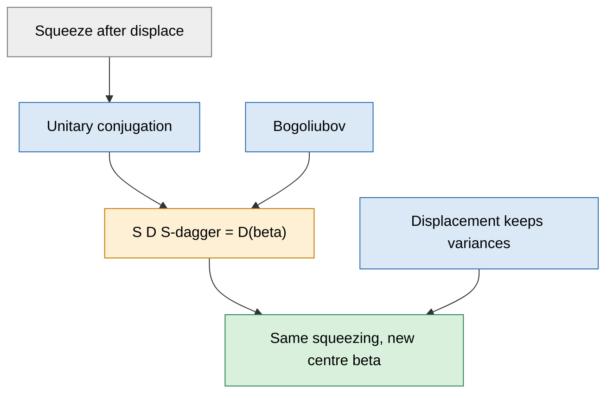

### Derivation

#### Step 1: Conjugating the displacement

Insert $\hat S^\dagger\hat S=1$: $\hat S(\xi)\hat D(\alpha)\left|0\right\rangle=\hat S\hat D(\alpha)\hat S^\dagger\;\hat S\left|0\right\rangle$. By the unitary-conjugation identity (Conventions), $\hat S\hat D(\alpha)\hat S^\dagger=\exp\big(\alpha\,\hat S\hat a^\dagger\hat S^\dagger-\alpha^*\hat S\hat a\hat S^\dagger\big)$. From (S2), $\hat S\hat a\hat S^\dagger=\mu\hat a+\nu\hat a^\dagger$ and therefore $\hat S\hat a^\dagger\hat S^\dagger=\mu\hat a^\dagger+\nu^*\hat a$. The exponent is

$$
\alpha(\mu\hat a^\dagger+\nu^*\hat a)-\alpha^*(\mu\hat a+\nu\hat a^\dagger)=(\mu\alpha-\nu\alpha^*)\hat a^\dagger-(\mu\alpha^*-\nu^*\alpha)\hat a=\beta\hat a^\dagger-\beta^*\hat a,
$$

with $\beta\equiv\mu\alpha-\nu\alpha^*$ (note $\mu\alpha^*-\nu^*\alpha=\beta^*$). Hence $\hat S\hat D(\alpha)\hat S^\dagger=\hat D(\beta)$ and

$$
\boxed{\hat S(\xi)\hat D(\alpha)\left|0\right\rangle=\hat D(\beta)\hat S(\xi)\left|0\right\rangle=\left|\beta,\xi\right\rangle,\qquad \beta=\alpha\cosh r-\alpha^*\mathrm{e}^{\mathrm{i}\theta}\sinh r .}
$$

#### Step 2: Inverse relation

Conversely $\hat D(\alpha)\hat S(\xi)\left|0\right\rangle=\hat S(\xi)\hat D(\alpha')\left|0\right\rangle$ with $\alpha'=\mu\alpha+\nu\alpha^*$. Check: $\mu\alpha'-\nu\alpha'^*=\mu^2\alpha+\mu\nu\alpha^*-\nu\mu\alpha^*-|\nu|^2\alpha=(\mu^2-|\nu|^2)\alpha=\alpha$.

#### Step 3: Squeezing is identical

By (S3) a displacement shifts $\hat x,\hat p$ by numbers and leaves all variances and covariances unchanged. Both orders produce a state $\hat D(\cdot)\hat S(\xi)\left|0\right\rangle$ with the same $\xi$, so they have the *same* covariance matrix (Problem 3.1): $\operatorname{Var}\hat X_{\theta/2}=\tfrac14\mathrm{e}^{-2r}$. Yes, the state is squeezed, by exactly the same amount and along the same axis; only the centre differs, $\left\langle\hat x\right\rangle+\mathrm{i}\left\langle\hat p\right\rangle=\beta$ instead of $\alpha$. Its Wigner function is the boxed formula of 3.1, Step 7, with $\alpha\to\beta$.

#### Step 4: Picture

For $\theta=0$: $\beta=\alpha\cosh r-\alpha^*\sinh r$, i.e. $\beta_r=\alpha_r\mathrm{e}^{-r}$, $\beta_i=\alpha_i\mathrm{e}^{r}$. Applying $\hat S$ last squeezes the whole phase-space picture, including the displacement vector: the centre is compressed along $x$ and stretched along $p$ by the same factors as the noise ellipse. Applying $\hat D$ last only moves the already-squeezed ellipse.

> [!success] Result
>
> $\hat S(\xi)\hat D(\alpha)\left|0\right\rangle=\hat D(\alpha\cosh r-\alpha^*\mathrm{e}^{\mathrm{i}\theta}\sinh r)\hat S(\xi)\left|0\right\rangle$: the same family of displaced squeezed states with a transformed amplitude; identical squeezing ($\tfrac14\mathrm{e}^{-2r}$ along angle $\theta/2$).
>

> [!warning] Check of your handwritten fragments
>
> Your line $\hat S\hat D\hat S^\dagger=\exp\big((\alpha\mu^*+\alpha^*\nu)\hat a^\dagger-\dots\big)$ appears to use $\hat S\hat a\hat S^\dagger=\mu\hat a-\nu\hat a^\dagger$, which is the formula for $\hat S^\dagger\hat a\hat S$. The sign of $\nu$ flips between the two (confidence $\sim$<!-- -->80% that this is what happened, from the legible part of the page); the correct amplitude is $\beta=\mu\alpha-\nu\alpha^*$.
>

## Problem 3.3: “Real” and “imaginary” cat states $\left|\alpha\right\rangle\pm\left|\alpha^*\right\rangle$

> [!quote] Problem statement
>
> Consider $\left|\psi_\pm\right\rangle=N_\pm(\left|\alpha\right\rangle\pm\left|\alpha^*\right\rangle)$. Normalise them, find their Wigner functions, and investigate their classicality.
>

> [!question] Conceptual challenges (answer each before reading on)
>
> 1.  Is $\left\langle\alpha\middle|\alpha^*\right\rangle$ real? (Its phase enters the norm.) $\to$ Step 1
>
> 2.  Why are these called “real” and “imaginary”? Relation between $\psi_{\alpha^*}(x)$ and $\psi_\alpha(x)$. $\to$ Step 2
>
> 3.  The Wigner function is quadratic in $\psi$: which four terms appear, and where in phase space does the interference term sit? $\to$ Steps 3, 4
>
> 4.  What symmetry does a real wave function impose on $W$? $\to$ Step 5
>
> 5.  What is the operational definition of a classical state, and why does negativity of $W$ prove non-classicality? $\to$ Step 6
>

### Concept map

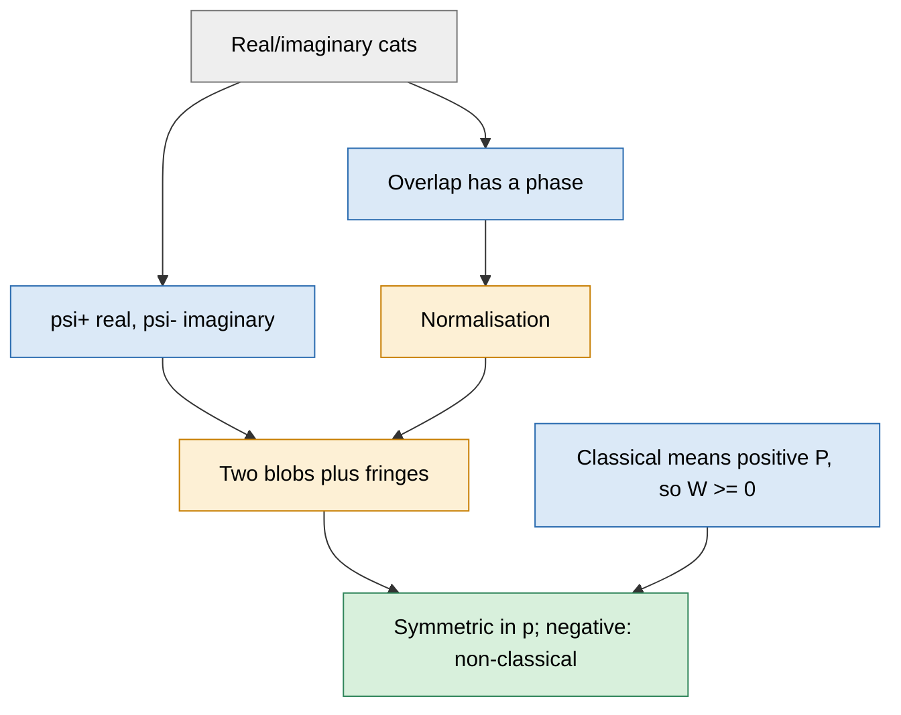

### Derivation

Throughout, $\alpha=a+\mathrm{i}b$ with real $a=\alpha_r$, $b=\alpha_i$.

#### Step 1: Normalisation

From the coherent overlap, $\left\langle\alpha\middle|\alpha^*\right\rangle=\exp(-|\alpha|^2+\alpha^{*2})$, and $\alpha^{*2}=a^2-b^2-2\mathrm{i}ab$, so

$$
\left\langle\alpha\middle|\alpha^*\right\rangle=\mathrm{e}^{-2b^2}\,\mathrm{e}^{-2\mathrm{i}ab}.
$$

$1=N_\pm^2\big(2\pm2\operatorname{Re}\left\langle\alpha\middle|\alpha^*\right\rangle\big)$ gives

$$
\boxed{N_\pm=\big[2\big(1\pm\mathrm{e}^{-2b^2}\cos2ab\big)\big]^{-1/2}.}
$$

#### Step 2: Why “real” and “imaginary”

From 3.1, Step 5 with $\xi=0$: $\psi_\alpha(x)=c\,\mathrm{e}^{-\mathrm{i}ab}\mathrm{e}^{2\mathrm{i}bx}\mathrm{e}^{-(x-a)^2}$, $c=(2/\pi)^{1/4}$; replacing $b\to-b$ gives $\psi_{\alpha^*}(x)=\psi_\alpha(x)^*$. Hence

$$
\begin{aligned}
\psi_+(x)&=2N_+c\,\mathrm{e}^{-(x-a)^2}\cos(2bx-ab)&&(\text{real}),\\
\psi_-(x)&=2\mathrm{i}N_-c\,\mathrm{e}^{-(x-a)^2}\sin(2bx-ab)&&(\text{imaginary}).
\end{aligned}
$$

In the Fock basis, $\left|\alpha\right\rangle\pm\left|\alpha^*\right\rangle=\mathrm{e}^{-|\alpha|^2/2}\sum_n\frac{\alpha^n\pm\alpha^{*n}}{\sqrt{n!}}\left|n\right\rangle$, i.e. coefficients $2\operatorname{Re}\alpha^n$ and $2\mathrm{i}\operatorname{Im}\alpha^n$; $\left\langle x\middle|n\right\rangle$ are real Hermite functions, consistent with the above. Special case $a=0$: $\alpha^*=-\alpha$ and $\psi_+$ is the even cat of HW1.3.

#### Step 3: Structure of $W$

For $\psi=N(\psi_\alpha\pm\psi_{\alpha^*})$, $\psi^*(x+y)\psi(x-y)$ contains two “diagonal” terms and two cross terms. Diagonal terms are the coherent-state Wigner functions (3.1, Step 7 with $r=0$):

$$
W_\alpha=\tfrac2\pi\mathrm{e}^{-2(x-a)^2-2(p-b)^2},\qquad W_{\alpha^*}=\tfrac2\pi\mathrm{e}^{-2(x-a)^2-2(p+b)^2},
$$

two blobs at $(a,\pm b)$, mirror images through the $x$ axis.

#### Step 4: Interference term

Using $\psi_{\alpha^*}=\psi_\alpha^*$, the cross term $\psi_{\alpha^*}^*(x+y)\psi_\alpha(x-y)=\psi_\alpha(x+y)\psi_\alpha(x-y)$:

$$
\psi_\alpha(x+y)\psi_\alpha(x-y)=c^2\mathrm{e}^{-2\mathrm{i}ab}\mathrm{e}^{2\mathrm{i}b(x+y)+2\mathrm{i}b(x-y)}\mathrm{e}^{-(x+y-a)^2-(x-y-a)^2}=c^2\mathrm{e}^{\mathrm{i}(4bx-2ab)}\mathrm{e}^{-2(x-a)^2}\mathrm{e}^{-2y^2},
$$

using $(u+y)^2+(u-y)^2=2u^2+2y^2$ with $u=x-a$. The $y$-integral is $\int\mathrm{d}y\,\mathrm{e}^{-2y^2+4\mathrm{i}py}=\sqrt{\pi/2}\,\mathrm{e}^{-2p^2}$, and $\frac2\pi c^2\sqrt{\pi/2}=\frac{2}{\pi}$. The other cross term is its complex conjugate. Together:

$$
\frac{4}{\pi}\,\mathrm{e}^{-2(x-a)^2-2p^2}\cos(4bx-2ab).
$$

$$
\boxed{W_\pm(x,p)=\frac{2N_\pm^2}{\pi}\,\mathrm{e}^{-2(x-a)^2}\Big[\mathrm{e}^{-2(p-b)^2}+\mathrm{e}^{-2(p+b)^2}\pm2\,\mathrm{e}^{-2p^2}\cos\!\big(4bx-2ab\big)\Big]}
$$

The fringes sit midway between the blobs (on $p=0$), and oscillate along $x$ — perpendicular to the separation vector $(0,2b)$ — with period $\pi/(2b)$: the larger the separation, the finer the fringes. Check of normalisation: $\int\mathrm{d}x\,\mathrm{e}^{-2(x-a)^2}\cos(4bx-2ab)=\sqrt{\pi/2}\,\mathrm{e}^{-2b^2}\cos2ab$ (Gaussian integral), so $\int W_\pm=2N_\pm^2(1\pm\mathrm{e}^{-2b^2}\cos2ab)=1$ $\checkmark$.

#### Step 5: Symmetry

For real $\psi$, substituting $y\to-y$ in the Wigner integral gives $W(x,p)=W(x,-p)$; the same holds for purely imaginary $\psi$ ($\psi^*\psi$ products pick up $(-\mathrm{i})(\mathrm{i})=1$). Both $W_\pm$ are visibly even in $p$.

#### Step 6: Classicality

A state is called classical if it is a statistical mixture of coherent states, $\hat\rho=\int\mathrm{d}^2\beta\,P(\beta)\left|\beta\right\rangle\left\langle\beta\right|$ with $P\ge0$. Since $W$ is linear in $\hat\rho$, such a state has $W=\int\mathrm{d}^2\beta\,P(\beta)W_\beta\ge0$. Hence *negative* $W$ somewhere $\Rightarrow$ non-classical. On the line $p=0$: $W_\pm(x,0)=\frac{4N_\pm^2}{\pi}\mathrm{e}^{-2(x-a)^2}\big[\mathrm{e}^{-2b^2}\pm\cos(4bx-2ab)\big]$. For any $b\neq0$, $\mathrm{e}^{-2b^2}<1$ and the cosine reaches $\mp1$ at some $x$, so the bracket becomes $\mathrm{e}^{-2b^2}-1<0$ there, while the Gaussian prefactor is positive: $W_\pm<0$. Both states are non-classical for every $b\neq0$; the negativity (relative to the peak) is strongest when the blobs overlap moderately and becomes a fine, fragile fringe pattern for $|b|\gg1$. Limit $b\to0$: $\left|\alpha^*\right\rangle\to\left|\alpha\right\rangle$. $\psi_+\to\left|a\right\rangle$, a coherent state, classical ($W>0$). For $\psi_-$, expand: $\left|a+\mathrm{i}b\right\rangle-\left|a-\mathrm{i}b\right\rangle\simeq2b\,\partial_b\left|a+\mathrm{i}b\right\rangle\big|_{b=0}=2\mathrm{i}b\,\hat a^\dagger\left|a\right\rangle$, because $\left|\alpha\right\rangle=\mathrm{e}^{-|\alpha|^2/2}\mathrm{e}^{\alpha\hat a^\dagger}\left|0\right\rangle$ and $\partial_b$ acting on it gives $(-b+\mathrm{i}\hat a^\dagger)\left|\alpha\right\rangle$. With (S3), $\hat a^\dagger\left|a\right\rangle=\hat D(a)(\hat a^\dagger+a)\left|0\right\rangle=\hat D(a)(\left|1\right\rangle+a\left|0\right\rangle)$: $\psi_-\to\hat D(a)(\left|1\right\rangle+a\left|0\right\rangle)/\sqrt{1+a^2}$. Expanding $W_-$ to order $b^2$ gives $W_-\to\frac{2}{\pi}\mathrm{e}^{-2(x-a)^2-2p^2}\frac{2(2x-a)^2+8p^2-2}{2(1+a^2)}$, negative at $(x,p)=(a/2,0)$: still non-classical.

> [!success] Result
>
> $N_\pm=[2(1\pm\mathrm{e}^{-2b^2}\cos2ab)]^{-1/2}$; $\psi_+$ is real, $\psi_-$ purely imaginary in the $x$ representation; $W_\pm$ = two Gaussian blobs at $(a,\pm b)$ plus fringes $\pm\frac{4N_\pm^2}{\pi}\mathrm{e}^{-2(x-a)^2-2p^2}\cos(4bx-2ab)$ on the $x$ axis; $W(x,p)=W(x,-p)$. Both states have negative $W$ for every $b\neq0$ and are non-classical; for $b\to0$, $\psi_+$ becomes the classical coherent state $\left|a\right\rangle$, while $\psi_-$ becomes the non-classical $\hat D(a)(\left|1\right\rangle+a\left|0\right\rangle)$.
>

> [!warning] Check of your handwritten fragments
>
> Your overlap “$\left\langle\alpha\middle|\beta\right\rangle=\exp(-\frac12|\alpha-\beta|^2)=\mathrm{e}^{-2b^2}$” keeps only the modulus. The phase $\mathrm{e}^{-2\mathrm{i}ab}=\mathrm{e}^{\mathrm{i}\operatorname{Im}(\alpha^*\alpha^*)}$ is not negligible here: it gives the $\cos2ab$ in $N_\pm$ and the fringe offset $-2ab$ in $W_\pm$. Your symmetry argument $W(x,p)=W(x,-p)$ for a real wave function is correct.
>

## Additional problem 3.A: Photon statistics of squeezed vacuum

> [!quote] Problem statement
>
> For $\left|\xi\right\rangle=\hat S(\xi)\left|0\right\rangle$ find (i) the Fock-state expansion and $P(n)$, (ii) $\left\langle\hat n\right\rangle$ and $\operatorname{Var}\hat n$, (iii) the Mandel parameter $Q=\operatorname{Var}\hat n/\left\langle\hat n\right\rangle-1$. Is super-Poissonian statistics a sign of classicality here?
>

> [!question] Conceptual challenges (answer each before reading on)
>
> 1.  Can the annihilation condition be turned into a recursion in the Fock basis? $\to$ Step 1
>
> 2.  Why are only even photon numbers present? $\to$ Step 1
>
> 3.  How to get moments of $\hat n$ without the expansion? $\to$ Step 3
>

### Concept map

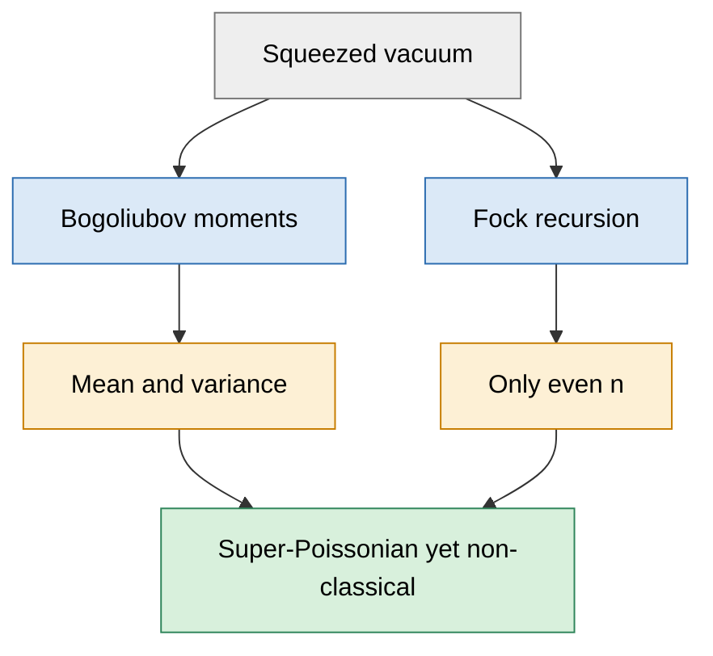

### Derivation

#### Step 1: Recursion

Write $\left|\xi\right\rangle=\sum_nc_n\left|n\right\rangle$ and apply $(\mu\hat a+\nu\hat a^\dagger)\left|\xi\right\rangle=0$; the coefficient of $\left|n\right\rangle$ is $\mu\sqrt{n+1}\,c_{n+1}+\nu\sqrt n\,c_{n-1}=0$:

$$
c_{n+1}=-\frac\nu\mu\sqrt{\frac{n}{n+1}}\,c_{n-1}.
$$

For $n=0$ this gives $c_1=0$, so all odd $c_n$ vanish (squeezing creates photons in pairs, $\hat a^{\dagger2}$). Iterating from $c_0$ with $t\equiv\tanh r$:

$$
c_{2m}=(-\mathrm{e}^{\mathrm{i}\theta}t)^m\prod_{k=1}^m\sqrt{\frac{2k-1}{2k}}\;c_0=(-\mathrm{e}^{\mathrm{i}\theta}t)^m\frac{\sqrt{(2m)!}}{2^m\,m!}\,c_0,
$$

because $\prod_{k=1}^m\frac{2k-1}{2k}=\frac{(2m)!}{(2^mm!)^2}$ (multiply numerator and denominator by $\prod 2k=2^mm!$).

#### Step 2: Normalisation and $P(2m)$

$\sum_m|c_{2m}|^2=|c_0|^2\sum_m\binom{2m}{m}\big(\tfrac{t^2}{4}\big)^m$. The binomial series gives $(1-4y)^{-1/2}=\sum_m\binom{-1/2}{m}(-4y)^m$ with $\binom{-1/2}{m}(-4)^m=\frac{\frac12\cdot\frac32\cdots\frac{2m-1}{2}}{m!}4^m=\frac{(2m-1)!!\,2^m}{m!}=\binom{2m}{m}$. So $\sum_m\binom{2m}m y^m=(1-4y)^{-1/2}$ and with $y=t^2/4$: $|c_0|^2(1-t^2)^{-1/2}=|c_0|^2\cosh r=1$:

$$
P(2m)=\frac{1}{\cosh r}\binom{2m}{m}\Big(\frac{\tanh r}{2}\Big)^{2m},\qquad P(2m+1)=0 .
$$

#### Step 3: Moments via Bogoliubov

$\left\langle\hat n\right\rangle_\xi=\left\langle 0\right|\hat S^\dagger\hat a^\dagger\hat S\hat S^\dagger\hat a\hat S\left|0\right\rangle=\left\langle 0\right|(\mu\hat a^\dagger-\nu^*\hat a)(\mu\hat a-\nu\hat a^\dagger)\left|0\right\rangle=|\nu|^2\left\langle 0\right|\hat a\hat a^\dagger\left|0\right\rangle=\sinh^2r$. For the second moment let $\hat b=\mu\hat a-\nu\hat a^\dagger$: $\hat b\left|0\right\rangle=-\nu\left|1\right\rangle$, $\hat b^\dagger\hat b\left|0\right\rangle=-\nu(\mu\hat a^\dagger-\nu^*\hat a)\left|1\right\rangle=-\nu(\mu\sqrt2\left|2\right\rangle-\nu^*\left|0\right\rangle)$, so $\left\langle\hat n^2\right\rangle=\|\hat b^\dagger\hat b\left|0\right\rangle\|^2=|\nu|^2(2\mu^2+|\nu|^2)$ and

$$
\operatorname{Var}\hat n=2\mu^2|\nu|^2=2\sinh^2r\cosh^2r=2\left\langle\hat n\right\rangle(\left\langle\hat n\right\rangle+1),\qquad Q=2\cosh^2r-1=\cosh2r>0 .
$$

#### Step 4: Interpretation

$Q>0$ (super-Poissonian, even more than thermal light with $Q=\left\langle\hat n\right\rangle$). Yet the state is non-classical: $\operatorname{Var}\hat X_{\theta/2}=\tfrac14\mathrm{e}^{-2r}<\tfrac14$ is impossible for any mixture of coherent states (each contributes at least the vacuum variance $\tfrac14$, and mixing only adds the variance of the means). Super-Poissonian statistics does not imply classicality; sub-Poissonian statistics and quadrature squeezing are separate sufficient criteria for non-classicality.

> [!success] Result
>
> $P(2m)=\binom{2m}{m}(\tfrac12\tanh r)^{2m}/\cosh r$, odd $n$ absent; $\left\langle\hat n\right\rangle=\sinh^2r$, $\operatorname{Var}\hat n=2\sinh^2r\cosh^2r$, $Q=\cosh2r$. Super-Poissonian yet non-classical (quadrature squeezed, pairwise photon structure).
>

## Additional problem 3.B: Squeezing under loss

> [!quote] Problem statement
>
> Squeezed vacuum with $\theta=0$ passes through a lossy channel modelled as a beam splitter of intensity transmission $\eta$ whose other input is vacuum. (i) Find the output $\operatorname{Var}\hat x$ and $\operatorname{Var}\hat p$. (ii) For $10$ dB of initial squeezing and $\eta=0.9$, how many dB survive? (iii) What is the maximum observable squeezing for given $\eta$? Is the output a minimum-uncertainty state?
>

> [!question] Conceptual challenges (answer each before reading on)
>
> 1.  Why can loss be modelled by a beam splitter, and which noise enters through the unused port? $\to$ Step 1
>
> 2.  Why do the variances of independent inputs add with weights $\eta$ and $1-\eta$? $\to$ Step 2
>

### Concept map

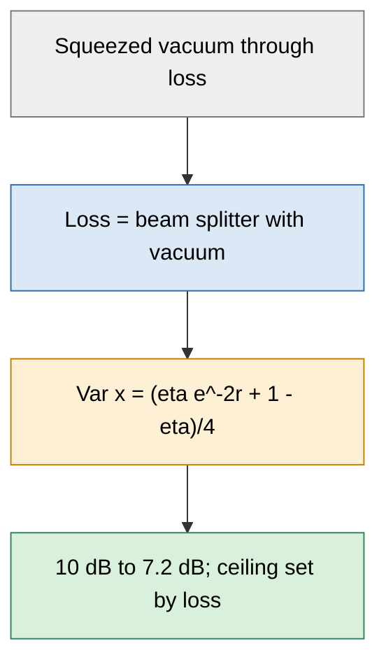

### Derivation

#### Step 1: Loss as a beam splitter

Loss must preserve $[\hat a_{\rm out},\hat a_{\rm out}^\dagger]=1$; $\hat a_{\rm out}=\sqrt\eta\,\hat a$ alone would give $\eta$. The minimal unitary completion is $\hat a_{\rm out}=\sqrt\eta\,\hat a+\sqrt{1-\eta}\,\hat v$ with an extra mode $\hat v$ (the environment) in vacuum. Since the coefficients are real, the same relation holds for the quadratures: $\hat x_{\rm out}=\sqrt\eta\,\hat x_a+\sqrt{1-\eta}\,\hat x_v$, and similarly for $\hat p$.

#### Step 2: Variances

The input is a product state, so $\hat x_a$ and $\hat x_v$ are uncorrelated and have zero means: $\left\langle\hat x_{\rm out}^2\right\rangle=\eta\left\langle\hat x_a^2\right\rangle+(1-\eta)\left\langle\hat x_v^2\right\rangle$ (the cross term $\left\langle\hat x_a\right\rangle\left\langle\hat x_v\right\rangle$ vanishes). With $\operatorname{Var}\hat x_a=\tfrac14\mathrm{e}^{-2r}$, $\operatorname{Var}\hat p_a=\tfrac14\mathrm{e}^{2r}$, $\operatorname{Var}\hat x_v=\operatorname{Var}\hat p_v=\tfrac14$:

$$
\operatorname{Var}\hat x_{\rm out}=\tfrac14\big(\eta\mathrm{e}^{-2r}+1-\eta\big),\qquad \operatorname{Var}\hat p_{\rm out}=\tfrac14\big(\eta\mathrm{e}^{2r}+1-\eta\big).
$$

#### Step 3: Numbers

In dB relative to vacuum, squeezing $=-10\log_{10}(4\operatorname{Var}\hat x)$. $10$ dB input means $\mathrm{e}^{-2r}=0.1$. Then $4\operatorname{Var}\hat x_{\rm out}=0.9\times0.1+0.1=0.19$, i.e. $7.2$ dB survive.

#### Step 4: Limit and purity

As $r\to\infty$, $4\operatorname{Var}\hat x_{\rm out}\to1-\eta$: at most $-10\log_{10}(1-\eta)$ dB (10 dB for $\eta=0.9$), regardless of the source. The product

$$
16\,\operatorname{Var}\hat x_{\rm out}\operatorname{Var}\hat p_{\rm out}=1+\eta(1-\eta)(\mathrm{e}^{r}-\mathrm{e}^{-r})^2>1\quad(0<\eta<1,\ r>0),
$$

(expand $(\eta\mathrm{e}^{-2r}+1-\eta)(\eta\mathrm{e}^{2r}+1-\eta)=\eta^2+(1-\eta)^2+\eta(1-\eta)(\mathrm{e}^{2r}+\mathrm{e}^{-2r})$ and use $\mathrm{e}^{2r}+\mathrm{e}^{-2r}=2+(\mathrm{e}^r-\mathrm{e}^{-r})^2$), so the output is no longer a minimum-uncertainty state: loss mixes in vacuum noise and makes the state mixed. Squeezing degrades linearly in loss, which is why high-efficiency detection is essential.

> [!success] Result
>
> $\operatorname{Var}\hat x_{\rm out}=\tfrac14(\eta\mathrm{e}^{-2r}+1-\eta)$; $10$ dB$\,\to7.2$ dB at $\eta=0.9$; ceiling $-10\log_{10}(1-\eta)$; the output is mixed and no longer minimum-uncertainty.
>
